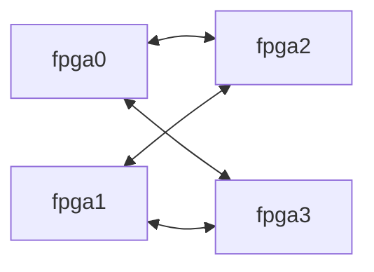

# EmuFlow

EmuFlow is a research-oriented multi-FPGA emulation flow. It compiles
synchronous RTL into per-FPGA netlists and a statically scheduled communication
fabric, with explicit interfaces between synthesis, partitioning, system
routing, TDM assignment, physical implementation, and global timing analysis.

The default research route uses **RapidWright device resources, native OpenPARF
placement, and RWRoute routing** for supported Xilinx FPGAs. VTR/VPR remains an
alternative academic backend, and Vivado is an optional proprietary backend.
Device resources and the inter-FPGA platform model are separate: a virtual
BoardDB is an academic model, not a deployable board or evidence of hardware
signoff. See [backend selection](#configuration-and-limits) for the explicit CLI
options for the research route and alternative backends.
The default [inter-FPGA research model](#inter-fpga-research-model) uses six
cables per connected FPGA pair, three corresponding HP-bank groups per cable,
twenty differential data pairs per bank,
and a single-hop delay of `30 + 0.5R` ns at TDM ratio `R`.

## Continuing from completed indexed inputs

`multi-fpga compile --prepared-frontend PHASE1_DIRECTORY --prepared-timing PHASE2_DIRECTORY`
continues at Phase 3 without synthesis or pre-partition STA. Both boundaries
must already be published and validated. The continuation checks their compact
design, mapping, device and complete DUT-clock contracts, binds SQLite payloads
read-only, and uses the current default BoardDB unless `--platform` is explicit.
It never inherits the saved frontend's old interconnect configuration. Supply
the original `--clock-period` values and source-sealed architecture timing data.
Do not use an active producer's temporary database as a completed boundary.
A native flow's published Phase 2 SQLite manifests may be supplied directly
without a standalone experiment report. The binder checks SQLite versions,
actual clock domains/periods, and path/weight publication row counts, then
records that bounded validation in the new run. Missing or broken payloads
fail; it does not rerun STA or reconstruct missing timing data.

The indexed Phase 3–7 data path supports the current HP-bank/cable model and
emits Phase 6 virtual wiring, binding, per-FPGA data-pin constraints and LVDS
adapters without reconstructing split circuits in Python. Phase 7 consumes the
sealed binding, adapter and XDC contract to materialize fixed LVDS IOB
boundaries, as described under [fixed virtual board wiring](#fixed-virtual-board-wiring).
`stage-metrics/*.json` records wall time and process-tree
RSS sampled every 0.5 seconds for each executed downstream stage. Large NVDLA
validation remains pending until the physical and global OpenSTA gates pass.

## Flow

| Phase | Responsibility | Algorithms and tools |
| --- | --- | --- |
| 1 | Synthesize and map RTL; preserve connectivity, primitive parameters, and resource demand in EmuIR | Yosys; mapping profiles for VTR hard blocks, generic soft logic, and Xilinx UltraScale+ |
| 2 | Extract timing paths and derive optimization weights | OpenSTA; optional Vivado timing provider |
| 3 | Cluster and partition against resource and topology constraints | TritonPart initial partitioning → PATRON post-processing; standalone TritonPart, RePart, MFSPart, and greedy alternatives |
| 4 | Route cross-FPGA multicast communication | Native C++ system router with topology, congestion, and timing costs |
| 5 | Assign TDM ratios, lanes, and slots to routed communication | Lagrangian ratio optimization, discrete legalization, and slot refinement; concrete event binding for supported combinational cuts |
| 6 | Plan pins/lanes, split the netlist, and generate transport RTL | Baseline pin planning; optional Chimew provider; static transport, shadow registers, and frame-barrier synchronization |
| 7 | Implement each FPGA and analyze whole-design timing | RapidWright/OpenPARF/RWRoute research route; alternative VPR/OpenPARF or Vivado backends; OpenSTA global timing |

Each stage has versioned artifacts and independent structural, legality,
coverage, or equivalence checks. Passing an intermediate stage does not
establish physical timing closure.

See [architecture and phase contracts](docs/FLOW_PLAN.md) and
[algorithm/provider overview](docs/ALGORITHMS.md).

## Algorithms and research foundations

EmuFlow integrates upstream EDA engines and implements the multi-FPGA glue and
system optimizers around them. The descriptions below distinguish direct tool
integration, implementations based on published methods, and EmuFlow-specific
extensions. A paper citation identifies the method's origin; it does not imply
that EmuFlow reproduces that paper's complete experimental setup or results.

### Phase 1: RTL synthesis and technology mapping

EmuFlow invokes [Yosys](https://github.com/YosysHQ/yosys) to run the RTL
synthesis flow: RTL elaboration, process and memory lowering, logic
optimization, LUT mapping, and mapping to supported device primitives.
The mapping profile determines whether RAM, DSP, and carry structures use
architecture-specific hard blocks or soft logic. These choices must agree
with the physical backend.

EmuFlow's contribution is the frontend integration and EmuIR representation:
stable cell/net identities, connectivity, primitive parameters, and resource
demand shared by the later stages. The VTR and Xilinx profiles describe
different target models, not interchangeable LUT-capacity units.

### Phase 2: timing extraction

[OpenSTA](https://github.com/The-OpenROAD-Project/OpenSTA) analyzes the mapped
netlist under the declared timing model and clock constraints. EmuFlow exports
the resulting path population, endpoint identities, and slack into
TimingPathDB, then derives criticality information for partitioning, routing,
and TDM optimization. A Vivado adapter is available for supported vendor flows.

This is pre-physical timing: inter-FPGA route, TDM events, and routed FPGA delays
are resolved later. Phase 7 performs the final global analysis.

### Phase 3: initial partitioning and post-processing

The default sequence is **TritonPart initial partitioning → PATRON
post-processing**, operating on the same atomic-cluster hypergraph.
[TritonPart in OpenROAD](https://openroad.readthedocs.io/en/latest/main/src/par/README.html)
produces the resource-balanced initial partition through multilevel
coarsening, initial partitioning, and uncoarsening with refinement. Multiple
vertex weights represent LUTs, registers, memories, and DSPs. EmuFlow checks
and repairs configured hop constraints before handing the initial assignment
to PATRON. See the [TritonPart project and publication](https://github.com/ABKGroup/TritonPart).

**PATRON is EmuFlow's communication-aware post-processing algorithm.** Its
native C++ local search starts from that assignment and considers single
atomic-cluster moves and bounded paired moves, including moving another
cluster out of the destination or moving two connected clusters together.
Candidates must preserve resource limits, fixed placements, board
reachability, and hop constraints.

For each candidate partition, PATRON incrementally updates the affected
communication-route estimates and directed link loads, estimates TDM ratios
from those loads and link capacities, and recomputes communication delay on
affected timing paths. The core estimate is
`predicted path slack = Phase 2 path slack − estimated communication delay`.
Thus, changing a partition changes the communication estimate used to score
it; this is more than optimizing a fixed set of net weights.

Default PATRON v6 accepts feasible improvements in lexicographic order:
maximize the worst normalized predicted slack, then improve the sum of
negative normalized predicted slacks toward zero; then minimize the number
of negative-slack paths, maximum estimated TDM ratio, maximum link-capacity
domain load, path snaking (revisits to an already visited partition), bit-hops,
and cut bits, in that order. Slacks use the TimingPathDB clock-normalization
policy. These are partition-search proxies, not final physical WNS/TNS.

PATRON post-processes the initial solution rather than restarting a complete
multilevel partitioning flow. Its default v6 route and TDM estimates do not
invoke or feed back actual Phase 4 routing, Phase 5 schedules, or Phase 7
physical results. Any claim of final timing improvement therefore requires a
separate complete-flow comparison. PATRON is the project's algorithm name,
not a claim to reproduce one particular paper.

Explicit alternatives include upstream **RePart**, with an optional
logic-replication route ([RePart paper](#selected-research-references)), and
EmuFlow's separately implemented **MFSPart-based** multilevel provider
([MFSPart paper](#selected-research-references)). Greedy partitioning remains a
baseline. It balances the declared cell/resource dimensions while retaining
hard capacity checks for all resources, including indivisible hard blocks.
Boundary policy is a separate choice: sequential-only and generalized
Static Exact admit different cut locations. Exact transport-event legality is
established after routing and TDM assignment, not by a Phase 3 timing proxy.

### Phase 4: system-level multicast routing

EmuFlow's native C++ router connects each cross-FPGA net's source to its sinks
on the BoardDB graph. It supports shortest-path and delay-demand-balanced tree
construction, additional Steiner-style candidates, and iterative rerouting.
Candidate costs account for delay, congestion, shared link capacity, and TDM
pressure, with separate treatment of intra-device SLL and inter-FPGA links
when the platform provides that distinction.

The research basis includes Wang et al.'s **Synergistic Die-Level Router**
(DAC 2025) and Chen et al.'s **Timing-Aware Optimization of Die-Level Routing
and TDM Assignment** (ASP-DAC 2026); links are in the
[reference list](#selected-research-references). The in-tree implementation
extends these ideas with EmuFlow's route contracts and candidate selection.
System routing selects FPGA/die paths; it does not route wires inside an FPGA.

The explicit `synergistic-author-route-v1` provider adapts the authors'
connection ordering and shared-tree maze search to BoardDB delays, capacities,
bank directions and hop constraints. It emits the common route contract and
uses the existing Phase 5 for TDM assignment. Physical bank directions and
SLL capacities are shared across transport rounds. Select it with
`--route-provider synergistic-author-route-v1` in complete compilation or
`--provider synergistic-author-route-v1` in `phase4`. The root build supplies
`emuflow_synergistic_author_router`; `--router` selects an explicit binary.
It currently requires one candidate worker, evaluates STA paths after routing
and does not accept TDM feedback. Full physical/global timing qualification
is pending; the default provider remains unchanged.
`--author-cost-policy author-sll-pressure-v1` enables experimental SLL scarcity
pricing without changing evaluated platform delays. Complete compilation,
frame search and cross-stage optimization also accept `best-of-two-v1`: both
author policies run through the same Phase 5, then a complete validated
route/schedule pair is selected by realized timing (completion slot when no
timing input exists). Ties keep continuous pressure. The selection receipt is
sealed with the flow artifacts; existing defaults remain unchanged.
Externally supplied timing test paths are also retained in the flow bundle.

### Phase 5: TDM ratio, lane, and slot assignment

The native ratio optimizer uses **Lagrangian relaxation/KKT updates**, followed
by discrete ratio legalization and local refinement. Its foundations are
Pui and Young's TODAES 2020 TDM method and the ASP-DAC 2026 timing-aware method.
The implementation includes a timing-DAG continuous optimizer and a separate
concrete slot optimizer; a continuous ratio alone is not an executable
communication assignment.

EmuFlow then materializes legal lanes and slots under the platform's ratio,
direction, compatibility, and shared-capacity rules. Slot refinement evaluates
concrete transmission events. For supported combinational cuts, the binding
also records when upstream values become available and when downstream
transmissions consume them. Those runtime bindings are EmuFlow integration
work, distinct from the cited ratio-optimization algorithms.
Indexed Static Exact schedules retain register-output roots alongside
combinational and register-input cuts under the same dependency/readiness checks.

For the default research platform, Phase 5 allocates whole communication
banks between the two directions of each connected FPGA pair according to
directional communication load, then optimizes TDM ratios and slots within
that allocation. Each bank serves one direction for the schedule. See the
[shared-bank capacity and delay model below](#inter-fpga-research-model).

### Phase 6: pin planning, netlist splitting, and transport

The **baseline** consumes the Phase 5 lane/slot assignment directly. The
optional **placement-aware** provider adds compatible signal grouping,
placement-proximity refinement, and minimum-cost group-to-virtual-pin matching.
Its normalized region model is an EmuFlow baseline.

The optional **Chimew** provider implements methods from *TDM Signal Grouping
and Package Pin Assignment for 2.5D Multi-FPGA Systems with Lookahead Placement*
(FPGA 2026): crossing-encoding grouping, position refinement, and two-stage
bank/channel assignment using min-cost flow. OpenPARF lookahead placement and
RUDY congestion estimates supply physical guidance. The implementation keeps
paper-derived kernels separate from EmuFlow's electrical, slot, and transport
adapters. Academic region estimates must be distinguished from actual SLR/SLL
data, and package binding requires a declared pin/electrical model.

For shared-bank platforms, physical lane remapping must remain inside the
direction banks allocated by Phase 5. Phase 6 rejects mappings that cross those
bank ranges or combine opposite directions in one bank.

All providers feed the EmuFlow netlist splitter and transport generator.
Static TDM communication, shadow state, and frame synchronization implement
the declared virtual-cycle semantics. These runtime mechanisms and their
equivalence checks are project implementations, not part of Chimew.

### Phase 7: FPGA physical implementation and global timing

Compact VTR netlist export preserves sparse SQLite identities through pin
binding, physical atom naming and boundary timing queries. Indexed partitions retain their declared
DUT clock requirements when generating runtime SDC.

The physical backends share a result contract but use different device models:

| Backend | Device model and physical algorithms | Upstream foundation |
| --- | --- | --- |
| RapidWright (default research route) | Supported Xilinx device resources and site/BEL connectivity; EmuFlow device/netlist adapters; native OpenPARF placement and validated site/BEL binding; RWRoute detailed routing | [RapidWright](https://github.com/Xilinx/RapidWright), [FPGA Interchange](https://github.com/chipsalliance/fpga-interchange-schema), [RWRoute](https://www.rapidwright.io/docs/RWRoute_timing_driven_routing.html) |
| VTR (alternative academic route) | VTR architecture XML; VPR architecture-aware packing, routing-resource graph and detailed routing; OpenPARF analytical placement, legalization and detailed placement, with VPR placement available as a baseline | [VTR/VPR](https://docs.verilogtorouting.org/en/latest/vpr/), [OpenPARF](https://github.com/PKU-IDEA/OpenPARF) |
| Vivado | Vendor synthesis/implementation integration and physical reports for supported inputs | Optional proprietary backend |

OpenPARF's heterogeneous placement framework and RapidWright/RWRoute's device
and routing work are cited below. RapidWright device support does not itself
supply a multi-FPGA board topology, cable specification, or board-link latency;
those belong to the separate platform model.

For an explicitly requested debugging continuation, `multi-fpga physical
--resume` with the native OpenPARF placer can reuse an existing route inside
the active experiment. It regenerates the route input and independently checks
the RouteDB, payloads, source identities and exact route-input SHA-256 before
reuse. A mismatch fails closed. Mapping and placement still run before this
check; this is not a persistent checkpoint cache. RapidWright logs heap usage
after input indexing, cell materialization and pin connection, and before and
after routing. `EMUFLOW_RAPIDWRIGHT_MAX_HEAP` accepts a positive Java `g`/`m`
size (default `32g`); choose it from measured demand and available HPC memory.
Extended clock-leaf paths use explicit source-to-sink PIP conversion and reject
missing hops. `scripts/rapidwright/EmuFlowClockPathProbe.java` qualifies this
conversion against a supplied node sequence in the pinned device database;
passing that probe alone does not qualify complete NVDLA routing.
Clock distribution includes both sink regions and the regions of selected
leaf buffers, including leaves reached across a region boundary.
Extended leaf lookup stops after the nearest legal BFS layer; within that
layer it prefers reuse and then a deterministic node-name ordering. It does
not expand deeper into fabric solely to find a reusable leaf.

The internal `_finish_rapidwright_routed_backend` entry point lets an explicit
debugging continuation time an independently validated completed route without
re-exporting its input or rerunning placement/routing. It uses the same timing
tail as a fresh run and preserves the fixed differential-I/O contract.
`_assemble_multi_fpga_physical_results` similarly checks and aggregates a
complete set of physical partition records without rerunning tools. It rejects
missing, duplicate, or failed partitions, retains the manifest's differential
I/O evidence, and publishes summaries only after both physical validators pass.
Neither helper alone qualifies whole-design Phase 7C or creates a persistent
intermediate cache; the NVDLA whole-design OpenSTA result remains pending.

For physical workers inside an active experiment, `multi-fpga physical --fpga
fpga1` implements only the selected FPGA through the normal backend. Repeat
`--fpga` to select several; each worker uses an isolated output directory and
the same immutable Phase 6 inputs. Completed partitions publish
`<out>/<fpga>/partition-record.json`, and an explicitly selected worker writes
`physical-partition-batch.json` with its input seals and record references.
This worker report does not publish a whole-design physical summary. Aggregate
all BoardDB partitions through the common checked assembler before Phase 7C.
Without `--fpga`, the command still implements and aggregates every FPGA.

Clock-region capacity is a separate placement requirement: UltraScale regions
support at most 24 distinct clocks ([AMD UG949](https://docs.amd.com/r/2024.1-English/ug949-vivado-design-methodology/UltraScale-Device-Clocking)).
The current native export records region geometry but disables native clock
planning because its clock-source and multi-resource adapters are incomplete.
For an explicit offline audit, run `python -m emuflow.xilinx_clock_capacity
--rwroute-input <rwroute.tsv> --architecture <architecture.json> --out
<clock-capacity.json>`. It streams the placed design, checks internal clock-pin
consumers, and rejects missing region identities. An incomplete region lookup
retains any overload already proved in known regions and reports unresolved
consumers explicitly; it cannot produce a passing certificate. Passing this necessary bound
does not qualify complete clock routing or clock timing. Clock-aware native
placement remains pending; extending a router search cannot certify an
over-capacity placement.

The native clock-planning candidate discovers internally driven clocks from
actual clock-sink connectivity when clock-region enforcement is enabled,
including gates implemented by ordinary logic models. It constructs only the
selected UTPlace2 or UTPlaceFX planner, so selecting UTPlace2 does not initialize
UTPlaceFX's incompatible single-RAM-class adapter. This foundation does not
enable clock planning in the default Xilinx export; native build qualification,
macro legalization under clock fences, and full NVDLA routing remain pending.

The native clock-region geometry tiles the complete dense placement grid,
including empty clock/SLR seam rows. Region indices follow dense coordinate
order; source region names remain recorded when remapped. This assigns
ownership to empty coordinates without adding sites or resource capacity and
keeps every physical site in its source region.

RWRoute may merge a physical I/O net into the canonical EDIF net of its
top-level port. The route certificate follows the I/O site pin's current net
ownership while retaining the original mapped net ID; an optional
`physical_net` field records the canonical name. A missing physical net fails
explicitly instead of dropping the logical net from coverage. The adapter has
passed the current independent route validator on NVDLA fpga1 with 716 fixed
I/O pairs, 2,605 certified nets and 101,783 PIPs. That partition also passed
the physical OpenSTA timing tail. Complete clock planning and whole-original-
design OpenSTA qualification remain pending.

Segment timing preserves nets explicitly declared `undriven` in the completed
source EmuIR as disconnected inputs. It records those declarations, creates no
replacement driver or timing source, and still rejects any requested path that
cannot be reached. Undeclared missing drivers and multiple drivers remain
errors; original TimingPathDB members are not dropped to make timing pass.

Finally, EmuFlow binds physical logic/interface delays, board-link delays, and
the selected TDM events to an abstract global timing model. **OpenSTA is the
default global STA engine**. The internal timing composer is a separate engine
option for explicit comparisons, not an implicit prerequisite for OpenSTA.
The binding/export layer is EmuFlow code; the STA engine computes timing on the
exported model. See [timing scope and metric definitions](docs/global-opensta-qualification.md).

### Selected research references

These references explain implemented methods and upstream foundations. Exact
source revisions and licenses are maintained in
[the component inventory](OPEN_SOURCE_COMPONENTS.md); implementation entry
points are mapped in [Algorithms and providers](docs/ALGORITHMS.md#implementation-and-reference-map).

- **TritonPart** — multilevel, multi-constraint partitioning, ICCAD 2023.
  [Author project and paper](https://github.com/ABKGroup/TritonPart).
- **RePart: Efficient Hypergraph Partitioning with Logic Replication Optimization
  for Multi-FPGA System** — 2026 preprint.
  [Paper](https://arxiv.org/abs/2604.00780), [source](https://github.com/Welement-zyf/RePart).
- **MFSPart: A Generalized Partitioning Framework for Multi-FPGA Systems and Its
  Ensemble-Based Extension** — TCAD 2026.
  [Author manuscript](https://zhiyaoxie.com/files/TCAD26_MFSPart.pdf).
- **Synergistic Die-Level Router for Multi-FPGA System with Time-Division
  Multiplexing Optimization** — Wang et al., DAC 2025.
  [Author manuscript](https://yibolin.com/publications/papers/ROUTE_DAC2025_Wang.pdf).
- **Lagrangian Relaxation-Based Time-Division Multiplexing Optimization for
  Multi-FPGA Systems** — Pui and Young, TODAES 2020.
  [Paper](https://cwpui.com/doc/j4.pdf), [DOI](https://doi.org/10.1145/3377551).
- **Timing-Aware Optimization of Die-Level Routing and TDM Assignment for
  Multi-FPGA Systems** — Chen et al., ASP-DAC 2026.
  [Author manuscript](https://numbda.cs.tsinghua.edu.cn/papers/aspdac262.pdf).
- **Chimew: TDM Signal Grouping and Package Pin Assignment for 2.5D Multi-FPGA
  Systems with Lookahead Placement** — Wang et al., FPGA 2026.
  [Paper](https://yibolin.com/publications/papers/FPGA_ISFPGA2026_Wang.pdf),
  [DOI](https://doi.org/10.1145/3748173.3779199).
- **OpenPARF: An Open-Source Placement and Routing Framework for Large-Scale
  Heterogeneous FPGAs with Deep Learning Toolkit** — 2023.
  [Paper](https://arxiv.org/abs/2306.16665), [source](https://github.com/PKU-IDEA/OpenPARF).
- **RapidWright: Enabling Custom Crafted Implementations for FPGAs** — FCCM 2018.
  [Official publication page](https://www.rapidwright.io/docs/Papers.html).
- **RWRoute: An Open-source Timing-driven Router for Commercial FPGAs** —
  [Author manuscript](https://www.rapidwright.io/docs/_downloads/3858e01e500602e00f7d5dda065b19ec/RWRoute_final_submitted.pdf).

## Inter-FPGA research model

`multi-fpga compile` and `run_multi_fpga_flow` use the bundled
`rapidwright_xcvu19p_4fpga_mesh` BoardDB when no platform is supplied.
The two-FPGA `rapidwright_xcvu19p_2fpga_p2p` model uses the same link rules for
single-hop work. These are specified research models, qualified as
**model-only**; their link parameters are not hardware timing signoff.
An explicit `--platform` or Python `platform_path` selects that BoardDB's own
capacity, topology, and delay definitions.

Device capacity comes from the matching RapidWright device/provider inventory
for `xcvu19p-fsva3824-2-e`, with LUT, FF, BRAM18K, DSP48, carry, and URAM units
kept distinct. The default four-FPGA preset applies a strict
`utilization_limit` of **0.25 per FPGA**, measured against each device's raw
capacity independently for LUT, FF, BRAM18K, DSP48, CARRY8, and URAM288.
The two-FPGA comparison preset retains its explicit 0.75 limit.
The default partition `balance_tolerance` is **0.1** for `cells`, LUT, and FF,
relative to the capacity-proportional design share (27.5% of design load per
identical FPGA in a four-way run). BRAM, DSP, URAM, carry, and other dedicated
resources remain visible to the partitioner as soft balancing dimensions, but
their hard acceptance bound is each FPGA's effective capacity (25% of the raw
device in this preset). This avoids splitting macro-heavy modules merely to
make every dedicated-resource count nearly equal. An explicit
`balance_dimensions` array in the partition constraints can select a different
set of dimensions for strict balance. Reports distinguish
`strict_balance_dimensions` from `capacity_only_dimensions` and record the
constraint mode and physical capacity for every active dimension. Capacity and
balance are separate upper bounds. Indivisible/fixed clusters, repair passes,
and validators never automatically relax either bound; infeasible integer
bounds fail explicitly.
OpenROAD/TritonPart can return a best-effort partition when its randomized
initializer does not produce enough multidimensionally balanced candidates.
When balance repair is enabled, Phase 3 therefore invokes the compiled
`emuflow_tritonpart_balance_legalizer` directly on the native hMetis graph and
solution. It uses exact integer bounds, moves no fixed vertex, and either emits
a legal assignment or fails the seed explicitly; it cannot widen a capacity or
balance bound. Its compact `balance-repair-report.txt` records RUNNING/PASS/FAILED
state, initial/final/allowed loads, and direct, paired, or bounded ejection-chain
move counts. The bounded chain handles cases where several complementary
resource vectors must move before a scarce-resource cluster can enter a target.
Python does not perform the production graph search: it parses the result and
independently recomputes the final per-FPGA resource loads before Phase 3 can
publish it.
Design and communication logic consume the device resources. FPGA-internal path delays come from the physical backend
and STA.
RapidWright checks the whole-device budget after transport mapping, before
routing the materialized circuit, and against its final occupied resources.
DSP component expansion counts one DSP site, paired LUT halves count one CLB
LUT, and BRAM36 consumes two BRAM18K units. Clock-prefilter logic is included.
Completed partition assembly rejects missing or mismatched resource-budget
evidence. Indexed Phase 3 publication seals the requested constraints;
terminal SQLite validation independently recomputes primary loads, replicated
capacity usage, and strict balance bounds against the selected platform.
Reports cannot widen their effective tolerance or reuse an older device budget. SLR window selection and OpenPARF density do not redefine the
whole-device utilization denominator or relax its limit.

The prior NVDLA partition used a requested/effective tolerance of 2.1 and
75% device budgets; its fpga0/fpga2 LUT loads exceed the new 25% contract.
Those Phase 3–7 outputs do not qualify the strict configuration. NVDLA
validation of 25%/0.1 is pending; original Phase 1–2 inputs remain reusable
under the explicitly authorized continuation without resynthesis.
The physical budget adapter passed a saved NVDLA fpga1 regression: a zero-LUT
budget was rejected before routing, while the 25% budget routed successfully
and independently matched 2,365 LUTs, 849 FFs, 21 DSPs and 37 CARRY8s.
BRAM and URAM were absent in that fixture. This backend check does not qualify
the new four-way strict partition; its complete NVDLA validation is in progress.

The four-FPGA topology connects each of `fpga0` and `fpga1` to both `fpga2` and
`fpga3`. There is no direct `fpga0`–`fpga1` or `fpga2`–`fpga3` link:



Each direct FPGA pair is connected by **6 cables**. Each cable uses **3 HP I/O
banks at each endpoint**, paired with the corresponding banks at the other
FPGA. This gives **18 bank groups per pair**, shared between the two directions.
Each HP bank supplies **20 differential data pairs** (40 data pins), for
**360 shared differential channels per FPGA pair**. Each scheduled `wire` is
one differential channel: two physical conductors carry one bit together.
Thus each direct FPGA pair has 720 data conductors and uses 720 data pins at
each endpoint. The 20-pair setting is the usable data width of this model.

The device inventory is **38 HP banks and 4 HD banks per FPGA**. Each FPGA in
the four-FPGA topology has two direct neighbors, so those links use
`2 * 6 * 3 = 36` HP banks at that FPGA. The remaining 2 HP banks and the 4 HD
banks are outside this inter-FPGA capacity pool. The two-FPGA variant uses
18 HP banks at each endpoint.

Phase 5 first chooses a whole-bank split from the two directional loads,
minimizing the worst predicted TDM ratio and then the sum of predicted ratios.
It then assigns TDM ratios and slots within that bank allocation and validates
the result. Banks within one cable can serve different
directions, but one bank cannot alternate directions between slots of the same
schedule. For each connected pair:

```text
b_AB, b_BA are nonnegative integers
b_AB + b_BA <= 18
C_AB = 20 * b_AB differential channels
C_BA = 20 * b_BA differential channels
```

For example, a 7/11 split gives 140 differential channels A→B and 220 B→A;
a 9/9 split provides 180 differential channels in each direction. Idle bank groups may remain unassigned.
BoardDB records `cable_count: 6`, `hp_banks_per_cable: 3`, `bank_count: 18`,
`wires_per_bank: 20`, and `capacity_sharing: "shared_bidirectional"`.
`data_lanes_per_direction: 360` is the pair's shared pool before directional
allocation; it does not provide 360 independent channels in both directions.
`wires_per_bank` counts differential pairs for this LVDS virtual-board model;
P/N conductors are never assigned separate TDM ratios or slots.

The single-hop net delay uses the TDM ratio assigned to that net on that hop:

```text
d_net(R) = 30 + 0.5 * R                       [ns]
path delay = intra-FPGA delay + sum_h d_net(R_h)
```

Thus `R=8` gives 34 ns and `R=16` gives 38 ns. A two-hop path with ratios 8 and
16 contributes 72 ns of cross-FPGA delay; each hop is evaluated separately.
The ratio term is already included in `d_net`, so this model does not add a
second slot-wait or serialization-delay term. The 250 MHz fabric clock controls
the concrete slot schedule; it does not replace the nanosecond delay formula.
`latency_cycles: 8` is the rounded-up R=1 reference (`ceil(30.5 / 4)`). The
scheduler computes `ceil(d_net(R) / 4)` for each entry's actual ratio.
BoardDB records the formula explicitly:

```json
{
  "tdm_delay_model": {
    "model": "linear-ratio-v1",
    "intercept_ns": 30.0,
    "ratio_coefficient_ns": 0.5
  }
}
```

Export either bundled platform for inspection or standalone phase commands.
`--wires-per-bank` explicitly overrides the effective data width when defining
a different research configuration; its default is 20:

```bash
emuflow platform research-model --wires-per-bank 20 --output build/research-boarddb.json
emuflow platform research-model --fpga-count 2 --output build/two-fpga-boarddb.json
emuflow platform validate build/research-boarddb.json

# Omit --platform to use the bundled four-FPGA model.
emuflow multi-fpga compile design.v --top top \
  --clock clk --clock-period clk=10 --out build/design

# Select a different platform explicitly.
emuflow multi-fpga compile design.v --top top \
  --clock clk --clock-period clk=10 \
  --platform build/two-fpga-boarddb.json --out build/design-two-fpga
```

The Python equivalent is `run_multi_fpga_flow(output_dir=..., sources=...,
top=..., clocks=..., clock_periods=...)`; pass `platform_path=...` to override
the same default. The bundled models are installed with the Python package
and the CMake CLI, so default selection does not depend on the current working
directory. `--physical` and the matching backend inputs are still required for
physical implementation and global physical timing. The bundled virtual-board
model now emits schedule-aware data-pin bindings as described below. The existing
independent-direction Phase 8A requirements exporter still rejects shared-bank
platforms instead of assigning two independent 360-wire pools.


### Fixed virtual board wiring

Both bundled XCVU19P presets declare
`virtual_board_model: xcvu19p-hp-lvds-cable-v1` and an explicit
`virtual_board_wiring` CSV. That checked-in table is the authoritative board
connection source consumed by Phase 6; the deterministic model and device-pin
inventory independently reject a stale or altered table. The table pairs **real device
P/N package pins** through **hypothetical fixed cables**, connecting P to P
and N to N. Each endpoint records its HP bank, vendor differential-pair ID,
both package pins, pin functions, and IOB sites. RapidWright supplies the
package-pin/site identity inventory; the AMD package pinout supplies the
P/N identities ([AMD FSVA3824 pinout, revision 1.3](https://download.amd.com/adaptive-socs-and-fpgas/developer/adaptive-socs-and-fpgas/package-pinout-files/usapackages/xcvu19pfsva3824pkg.txt)). Cable routing and connector data-contact numbering are model
assumptions, not observations of a commercial board.

The generator reserves configuration-multiplexed bank 65, then sorts link IDs
and assigns 18 unused HP banks at each endpoint of each link. It selects
complete vendor differential pairs in numeric pair-ID order, preferring the
20 non-GC pairs so the four global-clock pairs remain available by default. It never infers differential pairing
from adjacent package-pin names or IOB coordinates. Single-ended-only pins are
excluded. Bank group `g` belongs to cable `g // 3`; wire `w` belongs to bank
group `w // 20` with position `w % 20` at the default width. A cable has 60
differential data channels and 120 data-contact ordinals at each end.

The four-FPGA model has 24 cables, 1,440 differential channels and 2,880 signal
conductors. Each FPGA uses 36 distinct HP banks and 1,440 data pins; HP banks 65 and 78
remain outside the data network. No bank or pin is reused for a different
neighbor. The two-FPGA model has six cables and 360 differential channels.

There is **one undirected connection per differential channel**. Phase 5
assigns whole-bank directions for a generated schedule/build; reversing a bank
swaps transmitter and receiver on its fixed P/N pairs without changing polarity.
TDM communications in different slots reuse the same pair. P and N share one
wire index, TDM ratio and slot; they do not double the schedule capacity.

The checked-in [four-FPGA wire table](platforms/virtual/rapidwright_xcvu19p_4fpga_mesh.wires.csv)
and [two-FPGA wire table](platforms/virtual/rapidwright_xcvu19p_2fpga_p2p.wires.csv)
list all four package pins of every fixed differential connection. Regenerate
JSON/CSV tables without compiling a design:

```sh
python -m emuflow.virtual_board --out build/virtual-board
# Optional: --platform platforms/virtual/rapidwright_xcvu19p_2fpga_p2p.json
```

During Phase 6, a declared virtual board automatically produces:

- `split/virtual_board_wiring.json`: the fixed differential connection inventory;
- `split/virtual_board_binding.json`: each scheduled hop's wire, slot, TDM ratio,
  logical transport bit, and both endpoints' P/N pin/port identities;
- `split/<fpga>/virtual_data_pins.xdc`: `PACKAGE_PIN` and `IOSTANDARD LVDS`
  constraints for both polarities of used channels, with TDM reuse deduplicated;
- `split/<fpga>/virtual_differential_io.sv`: the differential adapter contract using
  `OBUFDS` at transmitters and `IBUFDS` at receivers. Its logical buses connect
  to transport RTL and its P/N ports define the physical top-level interface.

The Phase 6 validator checks these files against the device inventory, schedule,
transport ports and bank direction allocation. It rejects missing or altered
bindings, polarity swaps, pin collisions, and modified XDC or adapter RTL. The
logical netlist/anchor artifacts keep their existing board-independent status;
the separate virtual-board result records the additional differential binding.

The board assumes HP-bank `LVDS` at 1.8 V VCCO and internal 100-ohm receiver
termination (`IBUFDS.DIFF_TERM=TRUE`), enabled only at the receiving end
([AMD UG571, LVDS](https://docs.amd.com/api/khub/documents/kFbaUC5HGcXyGNauhgU6Gw/content)). These are design assumptions, not electrical
signoff. Clock/reset/control pins, power/ground wiring, configuration-pin reuse,
and a cable product's connector pinout need board-specific constraints. The
Phase 7 fails closed if the binding, adapter, or XDC differ. The RapidWright
backend consumes that sealed contract, lowers each used LVDS pair to a fixed
IOB at the P package pin with the inventory-verified N mate, and includes the
IOB boundary in routing and boundary timing. Its physical summary reports exact
lane/port/package-pin coverage. This is a routed research implementation, not
board electrical signoff: RapidWright's lightweight timing model does not
characterize the differential buffer's intrinsic delay, and the clock/reset/
control services above remain board-specific. Link timing keeps the configured
per-hop `30 + 0.5R` ns model; switching to differential does not recalibrate it.

## Build

The root CMake project builds EmuFlow's native kernels and selected in-tree
engines. Python packaging alone does not build a complete flow.

Required tools include CMake 3.20+, GNU Make, a C++17 compiler, Python 3.9+,
and Boost. The complete build also needs the development dependencies for
OpenROAD, OpenSTA, OpenPARF, and VPR: Bison, Flex, Tcl, SWIG, Eigen3, zlib,
spdlog, LEMON, OR-Tools, OpenMP, and the appropriate Python/PyTorch packages.
CUDA is optional and disabled by default. The OpenPARF Python/PyTorch ABI must
match the interpreter selected when compiling its native operators.

```bash
cmake --preset release
cmake --build --preset release --parallel 2
ctest --preset release
```

Build products are installed under `build/native/install/`.
For dependency-prefix configuration and partial development builds, see the
[user guide](docs/USER_GUIDE.md).

## Quick start

Use the CLI produced by the root build. This small frontend/transport example
explicitly selects the alternative VTR profile; it is not a RapidWright
physical-flow example:

```bash
export PATH="$PWD/build/native/install/bin:$PATH"
emuflow --help

emuflow arch fetch-default-vtr \
  --output build/architectures/vtr-flagship.xml

emuflow multi-fpga compile examples/rtl/counter.v \
  --top counter \
  --clock clk \
  --clock-period clk=10 \
  --mapping-profile vtr-hard-blocks \
  --physical-backend open \
  --platform platforms/virtual/academic_vtr_2fpga_p2p.json \
  --out build/counter-multi-fpga

emuflow multi-fpga validate --flow build/counter-multi-fpga
```

This example generates and validates the board-independent flow through
netlist splitting and transport. It does **not** request FPGA place-and-route
or demonstrate final physical WNS/TNS.

Physical execution is an explicit `--physical` continuation of compilation
and requires compatible architecture, timing, and backend inputs. Consult
`emuflow multi-fpga compile --help` and the
[physical-flow instructions](docs/USER_GUIDE.md#physical-implementation).

## Configuration and limits

The CLI and Python API default to `rapidwright` with
`xilinx-ultrascaleplus-open-v1` mapping. Supply the matching
device/provider, architecture, timing, and runtime
inputs described in the [user guide](docs/USER_GUIDE.md#physical-implementation).
Add `--physical` to execute placement and routing.

To use the alternative VTR route, explicitly select
`--physical-backend open --mapping-profile vtr-hard-blocks`. Standalone
`multi-fpga physical` also defaults to RapidWright; use `--backend open` for VTR.
Missing RapidWright inputs do not trigger an automatic VTR fallback.

Other CLI defaults are TritonPart initial partitioning followed by
timing-driven PATRON post-processing, `sequential-only` cuts, baseline Phase 6,
and OpenSTA global physical timing. Generalized Static Exact combinational
cuts and Chimew are explicit options. The integrated Chimew
lookahead path currently requires the explicit VTR backend/profile combination.

- State the period of every analyzed clock explicitly.
- Mapping profiles must match the physical device model; generic soft mapping
  can expand RAM/DSP-heavy designs substantially.
- Static Exact supports a constrained synchronous, single-virtual-clock
  semantic model. It is not arbitrary CDC or multi-clock signoff.
- Contest datasets supply communication graphs and topology constraints, not
  RTL or complete physical board specifications.
- Virtual BoardDB capacity and link assumptions must be distinguished from
  measured device and board properties.
- Bitstream generation and board bring-up require a supported concrete device,
  board support package, clock/reset configuration, and transport interface.
- RapidWright device/API dependencies have their own licensing conditions.
  Vivado is proprietary and is not bundled. The alternative VTR backend does
  not require Vivado.
- WNS/TNS are scoped to the declared source TimingPathDB population.
  Original-path TNS sums negative slack per original path, not once per
  unique register endpoint. Per-FPGA metrics are separate diagnostics.
  Original-IR timing projection preserves every materialized top-level output
  copy. Physical timing measures each copy and reports the worst per original
  path; the split net/bit bindings are checked independently. Output-copy
  timing with replicated cells is currently unsupported and fails explicitly.
  See [timing-model scope](docs/global-opensta-qualification.md).

Unsupported inputs must be reported explicitly; a backend must not silently
substitute a different architecture, mapping, or timing engine.

## Benchmarks

The [RTL catalog](benchmarks/rtl_catalog.json) identifies upstream designs,
licenses, and pinned source revisions. The
[full-flow matrix](benchmarks/end_to_end_validation_matrix.json) pairs real RTL
workloads with platform configurations; the
[contest matrix](benchmarks/contest_validation_matrix.json) separately covers
communication-algorithm inputs.

See [benchmark usage](docs/RTL_BENCHMARKS.md). Raw logs, experiment histories,
machine-specific paths, and temporary results are not project documentation.

## Repository layout

```text
src/          orchestration, native providers, and validators
engines/      selected EDA engines and their source provenance
schemas/      versioned artifact contracts
platforms/    virtual platforms and board-model inputs
providers/    provider manifests and integration recipes
rtl/          transport and runtime-synchronization RTL
benchmarks/   workload catalogs, platform matrices, and run contracts
examples/     small RTL and artifact fixtures
scripts/      build, import, and provider utilities
tests/        unit and integration regressions
docs/         architecture, usage, and validation documentation
```

## Documentation and contributing

- [User guide](docs/USER_GUIDE.md)
- [Architecture and phase contracts](docs/FLOW_PLAN.md)
- [Algorithms and providers](docs/ALGORITHMS.md)
- [Static Exact semantics](docs/STATIC_EXACT_COMBINATIONAL_CUT.md)
- [Contest/Phase 6 interface contract](docs/CONTEST_PHASE6_INTEGRATION_CONTRACT.md)
- [Validation requirements](docs/VALIDATION.md)
- [Contributing](CONTRIBUTING.md)

## License and source provenance

EmuFlow's first-party code is licensed under [Apache-2.0](LICENSE).
Included upstream components retain their own licenses and notices.

The source inventory includes [Yosys](https://github.com/YosysHQ/yosys),
[OpenROAD/TritonPart](https://github.com/The-OpenROAD-Project/OpenROAD),
[OpenSTA](https://github.com/The-OpenROAD-Project/OpenSTA),
[RePart](https://github.com/Welement-zyf/RePart),
[OpenPARF](https://github.com/PKU-IDEA/OpenPARF), and
[VTR/VPR](https://github.com/verilog-to-routing/vtr-verilog-to-routing).
See [the complete component and license inventory](OPEN_SOURCE_COMPONENTS.md),
[its machine-readable form](OPEN_SOURCE_COMPONENTS.json), and
[the implementation source manifest](SOURCE_MANIFEST.json).
