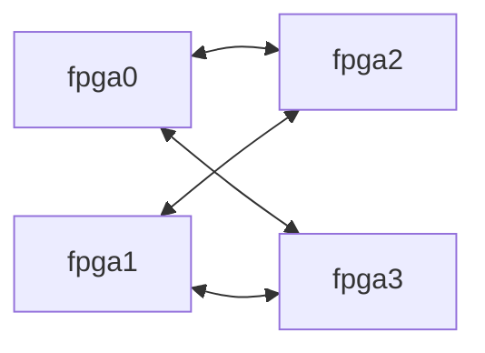

# EmuFlow

EmuFlow is a research-oriented multi-FPGA emulation flow. It compiles
synchronous RTL into per-FPGA netlists and a statically scheduled communication
fabric, with explicit interfaces between synthesis, partitioning, system
routing, TDM assignment, physical implementation, and global timing analysis.

The default research route uses **RapidWright device resources, native OpenPARF
placement, and RWRoute routing** for supported Xilinx FPGAs. VTR/VPR remains an
alternative academic backend, and Vivado is an optional proprietary backend.
Device resources and the inter-FPGA platform model are separate: a virtual
BoardDB is an academic model, not a deployable board or evidence of hardware
signoff. See [backend selection](#configuration-and-limits) for the explicit CLI
options for the research route and alternative backends.
The default [inter-FPGA research model](#inter-fpga-research-model) uses six
cables per connected FPGA pair, three corresponding HP-bank groups per cable,
twenty differential data pairs per bank,
and a single-hop delay of `30 + 0.5R` ns at TDM ratio `R`.

## Continuing from completed indexed inputs

`multi-fpga compile --prepared-frontend PHASE1_DIRECTORY --prepared-timing PHASE2_DIRECTORY`
continues at Phase 3 without synthesis or pre-partition STA. Both boundaries
must already be published and validated. The continuation checks their compact
design, mapping, device and complete DUT-clock contracts, binds SQLite payloads
read-only, and uses the current default BoardDB unless `--platform` is explicit.
For legacy prepared frontend snapshots, rebinding reads only the saved FPGA part
inventory before applying the current BoardDB; it does not require obsolete
platform fields or invent defaults for newly required TDM ratio limits. It never
inherits the saved frontend's old interconnect configuration. Supply
the original `--clock-period` values and source-sealed architecture timing data.
Do not use an active producer's temporary database as a completed boundary.
A native flow's published Phase 2 SQLite manifests may be supplied directly
without a standalone experiment report. The binder checks SQLite versions,
actual clock domains/periods, and path/weight publication row counts, then
records that bounded validation in the new run. Missing or broken payloads
fail; it does not rerun STA or reconstruct missing timing data.

The indexed Phase 3–7 data path supports the current HP-bank/cable model and
emits Phase 6 virtual wiring, binding, per-FPGA data-pin constraints and LVDS
adapters without reconstructing split circuits in Python. Endpoint, lane,
virtual-anchor and virtual-board binding rows live once in the sealed
`split/transport.sqlite`; the historical JSON paths are compact selector
manifests with explicit compatibility materializers. Phase 7 consumes lazy
views of the sealed binding, adapter and XDC contract to materialize fixed LVDS IOB
boundaries, as described under [fixed virtual board wiring](#fixed-virtual-board-wiring).
The transport writer opens its staging connection with SQLite URI handling
enabled so the immutable Phase 3 assignment sidecar can be attached reliably
on older production SQLite builds.
`stage-metrics/*.json` records wall time and process-tree
RSS sampled every 0.5 seconds for each executed downstream stage. Large NVDLA
validation remains pending until the physical and global OpenSTA gates pass.
Phase 3 additionally publishes `partition/phase3-runtime.json`. It separates
input loading, clustering, provider work, Static Exact contract construction,
validation, packing, JSON publication, and assignment-index publication. Each
record includes wall time, parent/child CPU time, sampled process-tree RSS and,
on Linux, parent-process I/O counters. Search, imported-solution, and replay
runs must be compared as distinct execution modes. Assignment-index
publication further separates exact-binary emission, primary and replica copy
rows, cut-sink rows, commit, and independent index validation.
Production PATRON input now streams a versioned little-endian typed protocol
directly to the native parser over standard input. Its fixed-width header,
canonical record tags, exact counts, CRC-32 trailer and EOF check reject mixed,
truncated, corrupted or concatenated input before partition search. The normal
path no longer formats the graph as decimal text or creates, flushes and
rereads `patron.in`. The trace records exact input bytes, records, CRC and
transport. Setting `EMUFLOW_PATRON_INPUT_COPY` explicitly selects the checked
legacy text encoder and retains an atomically published copy for differential
debugging. On a 100,000-cluster/net/path adapter fixture, typed encoding took
0.695 versus 0.992 seconds and native read plus execution took 0.208 versus
1.578 seconds; combined time fell from 2.570 to 0.904 seconds with
byte-identical native output. Typed IPC was 9,900,418 bytes versus 8,411,397
text bytes, so this result demonstrates conversion, parsing and disk removal,
not compression. Large NVDLA qualification remains required.
Inside PATRON, net driver/sink members and path-net members now occupy two flat
integer pools referenced by fixed-width ranges. The cluster-to-net and
net-to-path reverse relations are built by a bounded two-pass count/fill into
CSR, replacing one `std::set` and one `std::vector` object per graph row; the
unused ranked-path tree is gone. The four required mutable path orders now
retain their initial population in sorted vectors and allocate tree nodes only
for paths changed by accepted moves; ordered traversal merges that sparse
overlay with the unchanged vector and preserves every tie-break. Domain-to-path
membership uses the same model: one initial sorted vector per domain plus
sparse accepted-move additions and removals. A path's sorted dependency-domain
set occupies one 64-bit mask for the common small-domain case; designs with 64
or more domain ordinals retain a checked vector fallback. Each ProxyNet now
packs transitions, sink counts and domain counts into one integer payload,
replacing three separately allocated dynamic containers while preserving
sorted lookup and iteration semantics. On the same
500,000-cluster/net/path typed fixture, a direct three-run A/B against the
immediately preceding binary reduced maximum RSS from 448,577,536 to
400,588,800 bytes (-10.7%); median native time was 0.66 versus 0.67 seconds and
output was byte-identical. Cluster resource vectors now occupy one contiguous
`cluster x dimension` double pool instead of one heap allocation per cluster.
A second direct A/B reduced maximum RSS from 400,736,256 to 385,073,152 bytes
(-3.9%) at the same 0.65-second median, again with byte-identical output.
Relative to the original representation baseline, peak RSS has fallen from
769,146,880 to 385,073,152 bytes (-49.9%). The packed ProxyNet values and
weight pool still scale with graph content. This is adapter evidence, not NVDLA
qualification.
In the production PATRON path, the pressure model now has an explicit ownership
boundary: after native output parsing and optional diagnostic hashing, its
cluster/net/path/capacity views are cleared and collected before a compact
selection-only candidate is constructed. That transient candidate owns packed
cluster and instance placement plus resource summaries, but deliberately has no
cut records or Static Exact semantic contract because neither participates in
the PATRON v14 ranking. The generalized TritonPart initializer uses the same
selection-only shape when no explicit route-hop limit requires an independent
cut audit; configurations with a hop limit retain their cut relation. After
online validation and candidate selection, the
timing source, trace and unselected candidate state are released; the cut
relation and Static Exact contract are then constructed exactly once for the
selected assignment before the independent hop audit and assignment-index
publication. `phase3-runtime.json` records both release steps and the candidate
deferral. On an isolated 10,000-instance/9,999-cut compact chain, candidate
construction changed from 7.114 to 0.223 seconds, traced peak allocation from
44,885,378 to 96,969 bytes, and process peak RSS from 120,946,688 to 50,102,272
bytes. The deferred object is never published; the final artifact remains the
complete independently validated contract. This is adapter evidence, and its
NVDLA peak-RSS effect remains pending an exact-HEAD full replay.
Production clustering now consumes compact EmuIR through ordered integer
SQLite cursors. It keeps only a four-byte original-to-lexical cell permutation,
compact union-find arrays and the final cluster records; it no longer decodes a
second cell/net graph or retains the former instance dictionary,
name-to-index dictionary and grouped-member copy. The in-memory JSON path is
kept as the reference implementation, and differential tests require identical
cluster IDs, member order, resource totals, groups, fixed placement and policy.
Constraint normalization also leaves the complete instance identity catalog
unopened when no group or fixed-instance constraint needs it. Constrained
compact inputs read only the indexed identity column rather than decoding cell
resource payloads merely to validate names and patterns.
Compact candidate classification and final cluster aggregation decode and
validate each interned resource payload once, then reuse its immutable class or
resource vector for every cell that references it. This preserves per-cell
identity and resource accounting while avoiding repeated JSON parsing for the
millions of cells that share a small resource vocabulary. Their hot cell
cursors carry only the interned integer key; the JSON payload is fetched by
primary key only when that key first appears, rather than repeated by a
million-row join.
On a synthetic 300,000-cell singleton input, loading plus clustering reduced
traced peak allocation from 436.58 MiB to 212.52 MiB and wall time from 9.94 to
5.70 seconds. This is isolated construction evidence, not NVDLA qualification.
Combinational-cut characterization now uses the same compact source. Ordered
endpoint cursors feed a file-backed arc deduplicator and fixed-width CSR/SCC
arrays; each net retains at most one driver plus a multi-driver flag, and
eligible arcs are inserted in batches of at most 8,192. Clock/reset,
multi-driver and state-source nets do not accumulate sink populations. The
same validated endpoint pass also retains fixed-width per-net eligibility
summaries. After SCC, indexed lookups mark the uncommon cyclic sink owners, so
the candidate checker does not rescan all endpoints with cell and pin joins.
The remaining primary scan now reads only six integer endpoint columns. Cell
types are reduced to a one-byte sequential-input policy during the existing
cell pass, and the small interned pin-name table is loaded once by integer ID;
SQLite no longer performs two indexed joins or returns repeated type/port text
for every endpoint. Cell and net identity uniqueness is proven from SQLite's
complete single-column unique indexes instead of grouping both multi-million
row tables after their ordered scans; a missing or partial constraint still
fails closed. A
1,000,000-endpoint high-fanout regression stays below 16 MiB of traced Python
allocation. A separate 100,001-instance chain used 11.38 MB peak versus 90.99
MB for the reference path while preserving the same 100,000 eligible cuts.
Endpoint ordinals are stable ordering keys and may be sparse after a mapped
frontend filters unsupported or redundant pins. Compact candidate, pressure
and native Static Exact readers require non-negative, strictly increasing
ordinals within each net and role; they do not mistake a legal gap for a
missing logical endpoint. Endpoint row counts, roles, owners, pins, bits and
top-level identities remain independently validated.
Production cluster construction now exposes the packed lexical pool through a
private list-compatible streaming view: canonical JSON publication decodes one
name at a time, while default and explicitly mutable API callers still receive
an ordinary list. The logical policy array remains graph-sized on disk, and
direct bare-database callers still rely on their managed source seal.
New Phase 3 publications use assignment-index schema v4. SQLite is the indexed
typed owner for instance ownership, partitions, normalized cut records,
cut sinks and predecessor identities. Assignment-storage v4 removes the
complete `cut_nets` array from `assignment.json`; the JSON carries only its
record count and canonical ordered-record SHA-256. Phase 4--7 receive a
repeatable list-compatible ordered cursor, while explicit compatibility reads
reconstruct the unchanged logical assignment. Versions 1--3 remain readable.
The index is published before the selector, and archive retention treats the
selector, cluster store, assignment index and referenced exact binary as one
component. On an isolated
100,000-cut chain, the prior v3 JSON plus cut-sink index occupied 25,603,517
bytes and JSON loading peaked at 119,371,676 traced bytes. The v4 selector plus
normalized index occupied 17,117,431 bytes and a full sealed cursor traversal
peaked at 3,962,233 bytes; traversal took 1.54 versus 0.39 seconds. This is
storage-adapter evidence, not NVDLA qualification.
Static Exact
nodes, segments and captures are integer-coded in the versioned,
section-digested `assignment.exact.bin` data plane, partitioned by FPGA for
sequential reads. Phase 6 transfers the sealed binary by hard link when
possible. Its transport contracts keep only the semantic digest and sealed
storage descriptor; they no longer repeat source/consumer segment-ID arrays
for every scheduled hop. Production placement lowering joins the split SQLite
data plane directly and carries only boundary role plus digest, while explicit
legacy JSON expansion resolves detailed segment IDs on demand.
Phase 3 computes the canonical Static Exact digest when the final assignment is
created. Assignment-index publication reuses that validated owner-provided
identity instead of serializing the same multi-million-record contract for a
second hash pass. Explicit migration of detached legacy artifacts still
reconstructs and hashes its input independently. A same-input NVDLA Phase 3
replay reduced index publication from 1,086.81 to 361.53 seconds (-66.73%) and
total Phase 3 wall time from 5,719.81 to 4,999.22 seconds (-12.60%), with the
same semantic/binary digests, row counts, validation results and report hashes.
Peak process-tree RSS remained 42.70 GiB in that earlier replay. Since then,
the native analyzer result has stopped rebuilding dependency, launch, level,
and depth dictionaries in Python: those relations now remain in fixed-width
integer arrays/CSR and expand only the current cut while byte-backed semantic
records are emitted. The authoritative compact cluster owner now also keeps
cell identities in one UTF-8 pool, membership in CSR, resources in fixed-width
columns and only sparse fixed/group constraints; it exposes the unchanged v1
records lazily. `phase3-runtime.json` reports its retained column bytes as
`cluster_compact_payload_bytes`. On 200,000 singleton clusters, retained traced
allocation fell from 141.62 MB to 16.13 MB and process peak RSS from 323.91 MB
to 34.18 MB, with a byte-identical canonical SHA. Production publication now
writes that population once as chunked, compressed typed columns in
`clusters.sqlite`; `clusters.json` is a sealed selector, while explicit
compatibility reads reconstruct the unchanged logical v1 document. The same
200,000-cluster publication used 1,589,621 bytes versus 2,133,472 bytes for the
former compressed/base64 JSON envelope and took 1.85 versus 1.90 seconds.
The production TritonPart initializer now keeps that compact ownership through
its own export boundary. Vertex order and weights are lazy column views;
endpoint ordinals are grouped directly into packed hyperedges; and weighted,
unweighted, fixed and edge-class files are written as atomic record streams.
It no longer expands every compact cluster into a dictionary, builds a second
instance-to-cluster map, retains one dictionary per hyperedge, or joins the
complete hMetis text in memory. Deferred initializer assignments also retain
the compact instance-owner columns, and the independent balance validator
accumulates totals and per-FPGA loads in one cluster pass instead of creating a
second nested weight dictionary. On 200,000 synthetic two-member hyperedges,
the packed owner used 7,888,906 payload bytes and 8,372,861 traced bytes versus
147,099,118 bytes for the logical dictionaries. On 200,000 singleton clusters,
balance validation peaked at 22,376 traced bytes versus 56,891,500 bytes for
the former weight map. These are isolated representation measurements; the
same-input NVDLA replay remains the qualification gate.
The topology hop initializer now uses the same compact boundary. It derives
directed source/sink cluster ordinals from one ordered endpoint scan, stores
them in packed columns, streams the native protocol, and parses the native
assignment directly into a fixed-width part column. The unchanged-assignment
path carries that column into PATRON instead of rebuilding a cluster dictionary.
On 200,000 synthetic directed nets, retained traced allocation fell from
107,113,418 to 9,007,799 bytes with an 8,488,906-byte packed payload. A
200,000-cluster assignment used 845,764 traced bytes with an 800,000-byte
payload versus 31,886,472 retained bytes for the string dictionary. Generated
native input is byte-identical to the reference path; full NVDLA timing and RSS
qualification is still pending.
The native analyzer now stores instances, nets,
cuts, incoming/outgoing incidence and dependencies in flat columns/CSR. A
500,000-instance/net/cut differential run reduced its peak RSS from 136.89 MB
to 53.92 MB and produced identical bytes. These are isolated representation
measurements. A fresh NVDLA replay is still required to measure the stage peak
and attribute the remaining capture, policy-publication and compatibility
artifact costs.
`assignment.json` contains only the contract schema and SHA-256 identity;
explicit legacy-style reads reconstruct and verify the same logical contract.
Completed assignment-index v1/v2 artifacts remain readable.
For designs with at least 100,000 instances, Static Exact dependency-cone and
capture-cone traversal runs in `emuflow_static_exact_analyzer`. The boundary is
a versioned integer-only binary graph, and Python reconstructs the same v3
semantic contract after validating all returned indices and graph coverage.
Capture protocol v3 contains fixed-width integer ordinals only. For the
production compact EmuIR path, native input now scans `cell_records`,
`net_records` and integer `endpoint_records` directly. It does not build a
second instance-name-to-ordinal dictionary or decode every endpoint into Python
objects. Cut name/ordinal/class validation is one ordered merge instead of one
random SQLite lookup per cut. The analyzer returns `(cut, partition, net
ordinal, sink ordinal)` records; Python resolves them with one ordered merge
against the authoritative sink cursor, independently checking sink FPGA, state
type and assignment before constructing each capture identity. This removes
the ordered instance/net copies, graph-sized net-index map, per-capture whole-net
decoding and full post-native endpoint replay. Native dependencies use
predecessor CSR plus fixed-width launch, level, and depth arrays; a transient
successor CSR performs
independent topological validation and is released before contract publication.
Contract construction derives stable segment identities from ordered counters
and expands predecessor names for only the current cut. Production publication
derives cut nodes, dependency edges, logic segments and capture requirements
through repeatable typed record streams. For native production contracts, the
canonical SHA-256 reads compact cut/capture bytes, launch flags and
counter-derived segment ordinals directly. It does not invoke the dependency,
logic-segment or capture dictionary factories. The generic canonical encoder
remains the compatibility path for materialized and legacy contracts, and the
independent binary reader still reconstructs the logical contract and checks
the same SHA-256. Launch flags are frozen once before either view is built, so
later mutation of a caller-owned bytearray cannot split their identities. The
digest rejects mixed typed generations and truncated raw
nodes; the binary publisher independently rejects stateful-CSR disagreement,
noncanonical million-range segment identities and inconsistent capture coverage.
The `assignment.exact.bin` writer consumes the native predecessor CSR, launch
flags, raw cut-node bytes and raw capture bytes directly. It independently
checks every integer predecessor and counter-derived segment identity against
the canonical record view. Validated dependency edges enter typed temporary
spools in that single cursor pass before canonical section assembly, so a
stateful cursor cannot substitute an unvalidated second result. Capture-node
segment IDs retain the contract's lexical string order across six-digit
boundaries while binary logic records retain numeric global ordinals. The
writer produces the same section bytes without building a cut-name list/hash
table or expanding dependency and logic-segment dictionaries. Exact-binary v2 stores capture bits as
canonical unsigned big-endian byte strings, permits at most 8192 bits and still
reads v1 artifacts. Readers validate every section count against remaining
bytes before allocating from it. A 300,000-record synthetic adapter benchmark
reduced measured transient allocation from 44,295,916 to 20,615,888 bytes
(-53.5%); a sparse 100-capture parse fell from 89.9 ms and 22,222 bytes to
1.61 ms and 13,464 bytes. A separate 100,000-cell/100,000-net compact-input
microbenchmark reduced bridge peak Python allocation from 15.42 MiB to
2.03 MiB (-86.85%) and measured 1.50 seconds versus 1.58 seconds. These
measurements cover isolated adapter boundaries. On the same compact 100,000-cut,
100,000-capture writer input, direct integer publication reduced traced peak
allocation from 23.77 MiB to 9.71 MiB (-59.2%) and wall time from 14.368 to
6.135 seconds (-57.3%), with byte-identical binary and descriptor output. These
are not substitutes for the required NVDLA run. On a separate synthetic
10,000-cut chain with 79,964 dependency edges, three canonical-hash trials
changed from 0.832--0.847 seconds with logical dictionary replay to
0.736--0.762 seconds with the typed cursor; traced peak allocation remained
bounded at 0.039 MiB. This is isolated adapter evidence. Canonical hashing is
still linear in the logical record count. Compact combinational-candidate
characterization now reads ordered integer endpoints, deduplicates arcs in a
temporary relation and runs SCC over fixed-width CSR. PATRON pressure-model
construction likewise reads the compact EmuIR store through ordered joins,
interns UTF-8 identities once, and keeps cluster/net membership and driver/sink
relations in ordinal arrays. Indexed TimingPathDB v3 construction now attaches
the sealed path database read-only to the compact EmuIR connection and joins
path-net plus launch/capture identities directly to those ordinal domains. It
does not decode one Python path dictionary or perform two UTF-8 binary searches
per path-net incidence. On 100,000 paths with 800,000 path-net incidences and
20,000 compact nets, a same-input comparison reduced pressure-model
construction from 7.31 to 1.68 seconds (-77.0%) while producing the same
17,560,024-byte packed path payload. Process peak RSS remained in the same
78--90 MB range; this is adapter evidence pending an exact-HEAD NVDLA replay.
Native PATRON input is written record by record
through a synchronized same-directory temporary file; the previous `lines`
plus `join` copy is gone. Its strict reader checks logical schema, ownership,
bit ordinals, endpoint order and counts before any native search. Packed paths
encode every conservative transition with the complete `(-1, -1)` endpoint
sentinel; only exact transitions may carry two valid cluster ordinals, and they
are validated before the packed record is mutated. This prevents top-level
one-sided endpoint resolution from reaching the native protocol while keeping
the native reader fail-closed. Production summary-only PATRON output now uses a
versioned little-endian binary result with fixed objective/capacity/path
summaries, one uint32 part ordinal per cluster, a CRC-32 trailer, exact count
checks and atomic publication through `libemuflow_core`. Python memory-maps and
validates that result directly into the final packed ownership column; detailed
diagnostic traces retain the checked text protocol. On 500,000 synthetic
assignments, three isolated parses preserved the same 750,000 part-index
checksum. The result shrank from 7,889,054 to 2,000,284 bytes and median parse
time fell from 0.521 to 0.324 seconds. Median process peak RSS changed from
59,228,160 to 62,275,584 bytes because the typed path also maps the result and
checks its CRC. This is adapter evidence rather than NVDLA qualification. In
the production compact path, final `cN -> FPGA` ownership remains a four-byte
part-index column through assignment construction, online validation and Phase
3 packing; it is not expanded into a million-entry Python dictionary after the
native search. On 200,000 synthetic `ASSIGN` records, the materialized parser
retained 10,493,049 bytes and peaked at 15,757,674 traced bytes, while the packed parser
retained 804,115 bytes, peaked at 1,606,908 bytes and owned an 800,000-byte
payload. The same compact production path now keeps only per-FPGA cluster
counts and resource totals while constructing its transient partition summary;
the complete per-FPGA cluster-name lists are reconstructed only by an explicit
compatibility read after publication. On 200,000 compact clusters, retaining
those lists used 12,986,704 traced bytes, while the count-only traversal
retained 5,816 bytes (1.079 versus 1.098 seconds). These are isolated adapter
measurements rather than NVDLA qualification. A
million-sink synthetic membership comparison reduced process RSS from about
84 MiB to 28 MiB while changing construction time from 0.101 to 0.110 seconds;
the compact net identity/member/ordinal payload was 8,000,087 bytes. This is
isolated representation evidence rather than NVDLA qualification. Production
cluster publication now sends canonical JSON directly through zlib and
incremental base64 into the atomic temporary file. It no longer retains a
compressed-chunk list, joined compressed bytes, encoded bytes and the final
base64 string before the JSON writer starts. The emitted v2 artifact is
byte-identical and uses the existing reader. On a synthetic 100,000-cluster
artifact, traced publication peak fell from 3,203,902 to 400,854 bytes while
wall time changed from 2.246 to 2.494 seconds; the output was 1,058,932 bytes.
The runtime breakdown now attributes the complete operation to
`publish.write_clusters` instead of a separate `publish.pack_clusters` step.
This is a bounded-publication-memory improvement rather than a runtime or
NVDLA claim. Compact eligibility reconstruction now keeps one ordinal bit per
net plus a lexical UTF-8 identity pool with fixed-width offsets; clustering and
native Static Exact validation use the ordinal bitmap directly. A synthetic
1,000,000-name representation comparison reduced process peak RSS from
139,264,000 to 57,245,696 bytes with a 16,125,008-byte packed payload; build
time changed from 0.24 to 0.30 seconds. Production no longer turns that packed
view back into a retained Python string list before publication. In a separate
1,000,000-name construction-plus-canonical-encoding comparison, identical
14,000,014-character JSON used 11,327 versus 68,009,482 bytes of incremental
traced peak allocation and 64,749,568 versus 203,161,600 bytes of process peak
RSS; wall time was 1.780 versus 1.618 seconds. The policy array remains
graph-sized in the logical v1 schema. Compact production cut construction now
keeps net names in one UTF-8 pool, source/sink ownership in fixed-width CSR
columns, and endpoint counts in uint64 columns. Native dependency analysis,
semantic construction, validation and assignment publication expand only the
current record and consume a repeatable lazy net-identity view, while explicit
compatibility callers still receive the unchanged dictionaries. On 200,000
synthetic cut records, retained traced allocation fell from 85,428,138 to
10,995,827 bytes and process peak RSS from 246,202,368 to 35,536,896 bytes;
construction plus a complete logical traversal changed from 1.82 to 3.74
seconds and produced the same canonical SHA-256. This is isolated
representation evidence, not NVDLA qualification. Production MFSPart and
non-replicating RePart candidates now carry only partition facts through final
hop refinement; the authoritative Static Exact contract is constructed once
after the last assignment change. Explicit diagnostics retain intermediate
contracts, and RePart replication retains its separate effective-cut evidence.
For compact EmuIR, the native analyzer now opens `cell_records`, `net_records`
and `endpoint_records` read-only through the shared SQLite core. Its explicit
`--indexed-input EMUIR INPUT OUTPUT` mode uses input protocol v4: the request
contains only the selected partition column and cut coordinates. Python no
longer decodes every cell resource or scans and serializes all graph endpoints
for this boundary. In-memory reference inputs retain protocol v3, and both
modes return byte-identical v3 dependency/capture output in differential tests.
Native import checks the storage envelope, record coverage, resource payloads
and endpoint ownership before publishing. The streamed native path also invokes
`emuflow-native phase3 finalize-semantics TOPOLOGY METADATA OUTPUT`. C++ derives
final dependency levels, source/capture segment numbering and canonical packed
cut-node records from analyzer topology and streamed final identities. Python
maps the resulting private binary artifact instead of generating per-cut Python
dictionaries and retaining their complete packed bytearray. It independently
recomputes topology and checks every native record before normal
hashing/publication. For compact EmuIR,
`emuflow-native phase3 resolve-captures EMUIR REQUEST TOPOLOGY PARTS OUTPUT`
also owns endpoint resolution, canonical sorting/deduplication and final capture
bytes. A lifecycle-scoped SQLite uniqueness/index spool supports sorting and
independent coverage checks; Python maps the final binary offsets/payload and
removes that spool after validation. The independent validator scans the
requested source endpoints, checks each returned fact and uses one coverage bit
per canonical capture, without constructing another capture population.
In-memory reference inputs retain the explicit Python normalizer and the
unchanged 8192-bit logical capture contract. Canonical contract hashing,
exact-binary section publication and assignment/index publication still have
Python owners. Full NVDLA wall/RSS/I/O qualification remains pending.
The C++ analyzer now bounds protocol-v3
capture ordering to a 1,048,576-record run and a 64-way external merge instead
of retaining and sorting the complete capture population. Runs deduplicate
before merging; populations below one run stay in memory, while the final
ordered run streams into the atomic output in bulk,
and every private run is removed on success or failure. On 2,200,000 unique
captures, output remained byte-identical at 35,200,029 bytes while process peak
RSS fell from 185,663,488 to 133,627,904 bytes; wall time changed from 0.69 to
0.74 seconds and no sort file remained. This exercises multiple runs and the
merge path. A separate 1,100,000-way reconvergent duplicate case produced the
same single canonical capture as the old analyzer across a run boundary and
also left no sort file. These are synthetic results rather than NVDLA
qualification; Phase 3 temporary-I/O accounting must include the private
capture runs.
Smaller designs retain the Python implementation as an executable reference.
The analyzer now uses the first `libemuflow_core` components: representation-
scoped typed IDs, checked native artifact reads, and synchronized atomic binary
publication, plus shared SQLite RAII statements, transactions and database
lifetime handling. The installed `emuflow-native` entry now invokes the real Phase 3
analyzer, Phase 4 TLR router, Phase 5 exact scheduler and Phase 6 Chimew
signal-grouping, position-refinement, RUDY and bank/channel assignment kernels from one linked
stage library; production resolves this entry directly, while explicit differential runs retain
each standalone executable and older installs fall back to them. This is the W0/W7
foundation rather than a claim that native `compile` is complete; remaining
Phase 5 validation maps, Phase 6/7 data-plane loops, and global timing evidence
decoding are still migration work.
The three Phase 6 stages share the core CRC-32/SHA-256 implementation. Position
refinement now streams a sealed fixed-width protocol over stdin and parses
ordered stdout directly, removing its signal-sized text line list and both
input/output scratch files. A 100,000-signal serialization-only comparison
reduced traced Python peak allocation from 14.58 MB to 1.19 MB and process RSS
from 96.39 MB to 75.83 MB; the two-pass logical seal increased wall time from
0.53 to 1.59 seconds. The 3.30 MB typed payload is IPC traffic in production,
not a persistent artifact. RUDY now uses the same unified entry and streams its existing grammar over stdin/stdout, removing its net-sized text line list and input/output scratch files. This is adapter evidence, not NVDLA qualification.
Phase 4 now publishes `routes.json` as a small selector plus a
content-addressed `routes.<sha256>.sqlite` RouteStore. Demand identities are
projected from their authoritative routed records; route sinks, tree edges,
exact predecessors and timing paths are normalized relations instead of one
graph-sized JSON tree. `read_system_routes` exposes ordered lazy cursors to
Phase 5, while `read_json` remains the explicit legacy materializer. The final
multi-FPGA report inventories and seals both selector and sidecar. RouteStore
user version 2 introduced typed global-router master selections and
refinement-batch path membership. User version 3 additionally owns route
width, transport round, cut class, dependency level/depth, maximum latency and
predicted delay as typed columns, removing the last per-route scalar JSON
payload. Readers retain strict v1/v2 support, and v3 rejects unknown scalar
fields instead of silently preserving another embedded data plane. These
route/path-sized arrays no longer reside in the selector header and are
exposed as lazy sequences. Managed
global routing validates each native candidate as it is parsed and retains one
capacity-domain bitset per demand for independent batch reconstruction. It no
longer rebuilds the complete multi-generator candidate-tree pool in Python;
`phase4 --retain-candidate-pool` remains available for diagnostics and exact
oracle tests. On a synthetic 50,000-demand output containing 350,000 candidate
records, the isolated parser's process peak RSS fell from 252,018,688 to
45,809,664 bytes while wall time changed from 0.606 to 1.148 seconds because
the compact path performs tree, delay, lock and final-route checks online.
This is adapter evidence rather than NVDLA qualification. The native-only
demand and timing-path model now uses fixed-width columns plus CSR offsets;
capacity checks and the native text writer consume typed cursors without
retaining one dictionary and nested list per demand or path. On 100,000
two-sink demands plus 100,000 two-demand timing paths, construction and a full
traversal reduced retained traced allocation from 83,580,870 to 10,741,799
bytes and process peak RSS from 226,361,344 to 35,667,968 bytes. The packed
payload was 10,400,016 bytes and the checksum was unchanged; wall time changed
from 0.247 to 0.431 seconds. This isolates Phase 4 model representation and is
not NVDLA qualification. Native result parsing now keeps route arc spans,
delays, timing scalars and master-selection ordinals in fixed-width columns.
The production unified entry writes those records to a strict typed SQLite
result relation instead of a graph-sized line protocol. Final route arcs stay
normalized, while validation-only candidates are packed once per demand
alongside typed selections, timing values and metrics. The adapter rejects an
unknown table, column, type, version, duplicate record or trailing bundle byte,
then performs the same independent tree, delay, lock, coverage and final-route
checks. An explicitly selected standalone router retains the text protocol for
differential compatibility.
The production `run_phase4` path exposes repeatable logical cursors over those
columns, so independent validation and RouteStore publication no longer retain
the native route dictionaries beside a second complete public route/timing/
selection object graph. Direct `route_system_native` callers retain an explicit
mutable compatibility materialization. On 100,000 one-edge routes plus timing
and selection results, the isolated additional result state and a complete
route/selection traversal reduced retained traced allocation from 144,806,088
to 6,737,103 bytes and process peak RSS from 352,944,128 to 71,499,776 bytes;
the packed payload was 6,700,000 bytes and wall time changed from 0.405 to 1.066
seconds. A separate 100,000-demand, seven-candidate, one-edge A/B produced the
same complete logical SHA-256. The native result artifact fell from 33,100,858
text bytes to 16,261,120 typed SQLite bytes and producer wall time fell from
0.58 to 0.43 seconds. Independent compact parsing and semantic checks took
2.827 versus 2.839 seconds; native peak RSS rose from 85,737,472 to 105,693,184
bytes. These are synthetic adapter measurements rather than NVDLA
qualification. On an isolated 100,000-route scalar-relation comparison, v3
used 12,832,768 bytes versus 21,127,168 bytes for the v2 JSON-bearing relation
(-39.26%); insertion plus both identity indexes took 0.152 versus 0.155
seconds. This measures only the route scalar relation, not a full NVDLA stage.
The production unified path now leases the checked native SQLite result through
RouteStore publication. The writer stages only assignment-owned route identity,
dependency and latency metadata, attaches the native result read-only, and
inserts final route rows, arcs and master selections with set operations. The
logical and ordered-record seals are generated from the final lazy RouteStore
view, so publication never invokes the Python projected-route record builder.
The private native result is released on both successful and failed Phase 4
publication. On 100,000 one-edge routes, three isolated runs preserved the same
logical SHA-256 and identical 24,461,312-byte stores; median publication time
changed from 3.187 to 3.027 seconds. Median process peak RSS changed from
49,512,448 to 58,179,584 bytes because the direct path keeps bounded SQLite
page caches for the source, staging relation and final seal reader. This is
adapter evidence rather than NVDLA qualification. Final timing-path records and
refinement-batch membership still originate in the Python adapter, and C++ does
not yet own the RouteStore selector/metadata publication lifecycle. The
independent Phase 4 timing validator now retains one `net -> rank` identity
index plus fixed-width route-delay, TDM-delay and route-signature columns. It
releases those columns before the second common timing reconstruction, which
uses the same bounded representation independently and accumulates worst-path
summaries online unless a timing-evaluated compatibility caller explicitly
requests every path record. On 100,000 single-route/single-path records, an
isolated representation and full traversal comparison reduced retained traced
allocation from 55,930,961 to 11,253,809 bytes and process peak RSS from
158,416,896 to 47,890,432 bytes; the fixed-width payload was 3,200,008 bytes,
the checksum and worst path were unchanged, and wall time changed from 0.221
to 0.248 seconds. This is adapter evidence rather than NVDLA qualification.
RouteStore
publication validates the previous selector before writing, restores it on a
selector or post-publication validation failure, and removes an obsolete
sidecar only after the new view passes. The selector binds the sidecar filename
to its store digest. Normal publication does not run `VACUUM`, because the
append-only build has no delete fragmentation to recover. Validation archives
apply one retention decision to every generic selector/sidecar dependency
group, so a copied selector cannot lose a large hash-only sidecar.
For indexed Static Exact workloads with at least 100,000 routed cuts, Phase 5
now runs dependency ordering, conservative source readiness, earliest legal
lane/slot assignment, and sink-completion propagation in
`emuflow_tdm_exact_scheduler`. Small cases continue to execute the Python
reference for differential coverage. Phase 5 now publishes the logical
schedule as a compact `schedule.json` manifest plus a versioned,
content-addressed `schedule.<sha256>.sqlite` ScheduleStore. The SQLite object
is published first and the manifest switches generations last, so an
interrupted overwrite leaves the previous schedule readable. Phase 5 also
stages the ScheduleStore, selector, cross-layer contract and report as one
generation. `phase5_report.json` is the commit point; any failed replacement
restores the prior selector, sidecar, cross-layer contract and report
byte-for-byte. The report carries a canonical self-identity plus the name,
size and SHA-256 of every other Phase 5 artifact. Publication fsyncs every
staged member, makes all pre-report directory entries durable, and only then
replaces and syncs the report. A SIGKILL or power loss before that final commit
therefore leaves the old report visible; direct Phase 5 validation, Phase 7C
and canonical/shared replay reject any partially visible mixed generation
before opening its schedule or cross-layer contract. Legacy report-less data
is accepted only through an explicit compatibility option. Ordered routes, hops, demand
completions and domain records are stored once; `read_json` remains the
explicit compatibility materializer. Native hop output remains in a fixed
record file and is exposed through a lazy, memory-mapped list-compatible view;
Phase 5 validates every record but no longer creates one resident Python
dictionary per hop before ScheduleStore publication. A versioned canonical
typed cursor maps fixed records directly to the ScheduleStore entry relation,
and the writer derives canonical records while computing both logical seals and
each section seal in one bounded pass. Static Exact entries are not also kept
as JSON rows. Native hops therefore reach ScheduleStore without first becoming
Python dictionaries. Native completion output uses the same retained record
file through a demand-ordered lazy view; only fixed-width record offsets and
demand ranks remain resident. Sink arrivals used while constructing the
independent dependency certificate live in a packed net-rank by FPGA-rank
`uint32` matrix instead of a tuple-keyed Python dictionary. In a synthetic
100,000-route/two-sink comparison, the former completion and arrival objects
retained 65.70 MiB of traced allocation. The replacement uses 2.67 MiB of
packed resident arrays plus a 3.05 MiB native record file; a complete lazy
traversal added 0.014 MiB traced peak. This is adapter evidence, not NVDLA
qualification. Phase 6 now reads the ScheduleStore
through a typed SQL projection which validates and joins routes without
per-hop `json.loads` or Python entry/route dictionaries. When a typed pin plan
is present, both streams use the same natural identity order, including IDs
past six digits, before lockstep validation. Qualified Static Exact publication
uses ScheduleStore v4: routes, route sinks/edges, completions and sink arrivals
are typed relations, while only link-domain-scale records remain JSON.
Cross-layer timing and the baseline splitter consume these relations directly;
entry-route reconstruction uses one set query rather than two sink/edge queries
per hop. Cross-layer timing contract v2 binds the RouteStore and ScheduleStore
digests plus the validated hop count; it verifies exact hop coverage by merging
their ordered typed cursors and does not copy hop identities into
`cross_layer_timing.json`. Physical timing derives the same canonical records
from the bound ScheduleStore. Materialized v1 contracts remain independently
validatable. A synthetic 100,000-route one-hop Static Exact build reduced Python
peak allocation from 346.1 MB to 108.2 MB, retained allocation from 332.9 MB
to 83.5 MB, and route artifact bytes from 46.60 MB to 32.19 MB; two repeated
runs measured the typed build at 8.16--8.32 seconds versus 8.92--9.59 seconds
for whole-JSON loading. This is adapter evidence rather than NVDLA
qualification. Canonical full-bundle validation now opens RouteStore and
ScheduleStore with their typed readers for runtime replay and Global STA; it no
longer expands either logical document through `read_json`. Static Exact deadline
generation and its independent validator also query the ScheduleStore directly:
a `schedule_routes(net)` index resolves the demand, and the existing demand-led
entry key supplies source and arrival hops without H-sized entry, source or
arrival maps. Older stores build a file-backed compatibility index. On 20,000
unique segments, complete build plus validation reduced traced peak from
76,146,572 to 18,087,840 bytes and process peak RSS from 209,158,144 to
88,129,536 bytes; wall time improved from 2.14 to 0.90 seconds with the same
status and record count. This is adapter evidence pending NVDLA Phase 7C
qualification. The independent typed validator now reconstructs the exact
ready order with packed CSR arrays and net ranks, stores arrivals in a compact
integer matrix, streams certificate digests and compares recomputed completion
rows through a bounded temporary SQLite relation. It no longer retains the
route-level exact-node, successor, indegree, order, completion or tuple-keyed
arrival Python maps. At 100,000 routes, an independent-root fixture used 13.88
MiB peak versus 316.65 MiB for the reference validator (4.55 versus 6.94
seconds); a 99,999-edge chain used 5.51 MiB versus 338.55 MiB (5.25 versus
6.33 seconds). The native adapter still retains route-scale compact columns,
and the ratio-delay baseline branch still performs hop-scale
work when a platform declares a TDM delay model. Production Phase 6 dispatch reads only the lazy
schedule entry count, and Phase 7C plus physical/local timing consumers open
RouteStore lazily. Terminal full-bundle validation still uses compatibility
materialization in some replay paths and remains migration work. The retired
canonical checkpoint compatibility code inventories complete Phase 4 and
Phase 5 output directories because content-addressed sidecar names are unknown
when a static experiment specification is compiled. Its shared materializer
resolves RouteStore and ScheduleStore selectors, copies each referenced
sidecar before its selector, and rejects dangling selectors. A managed root
checkpoint has already sealed the directory bytes, so this compatibility path
checks the strict selector envelope, content-addressed basename and declared
file size without opening or rehashing the large SQLite stores. The trusted
root seal also binds the Phase 5 report and its member table, so this bounded
path still detects a dangling or cross-generation selector. Standalone
replay still performs full content hashes and semantic validation. This
preserves historical artifact validation without re-enabling checkpoint
execution in the production lifecycle. Older v1--v3
stores remain readable. Phase 6
batch-streams endpoint, lane, anchor and fixed-board binding records into one
content-sealed TransportStore. Validation and RTL/XDC consumers iterate its
selectors without rebuilding global hop dictionaries. Unique differential
adapter endpoints are normalized once in a typed relation, so XDC and
SystemVerilog generation scale with physical port count instead of rescanning
all scheduled hops for every FPGA. Those XDC and SystemVerilog artifacts are
written atomically as streams, and independent validation compares streaming
digests instead of building expected and observed whole-file strings.
The same store now carries one `binding_physical_ports` row per real
differential pair, including its member count and ordered member seal. Indexed
physical-I/O contract v2 reads this bounded relation instead of rescanning and
serializing every hop for every FPGA. Its reader independently recomputes each
port's member count and seal from the authoritative binding-entry cursor before
accepting the compact row. RWRoute accepts v1 and v2 without
changing lane, slot, direction or fixed-pin semantics. On a synthetic
200,000-hop, one-pair fixture, the emitted contract JSON fell from 3,001,270 to
1,645 bytes (-99.95%). The current reader also performs the independent ordered
membership scan, so timing and RSS must be measured again; NVDLA qualification
remains pending.
Placement-aware pin plans are published as a compact `pin_plan.json` selector
plus a sealed `pin_plan.sqlite`. Transport construction lockstep-merges its
typed lane cursor with schedule entries instead of building another hop-sized
lane dictionary and coverage set. Its first generic validation joins sealed
schedule, plan and position relations in a file-backed SQLite workspace, then
publishes the final selector and store only after generic and provider-specific
checks pass. The indexed Chimew electrical validator also joins the sealed
schedule and plan stores through a lifecycle-scoped SQLite membership relation,
so it no longer rebuilds schedule, plan, or coverage maps per hop. Legacy
logical pin-plan JSON remains readable. Position hints now use the same compact
selector plus indexed-SQLite pattern, and generic production and validation
ordered-merge typed schedule, position and plan relations without a hop-sized
hint dictionary. Pin-plan and position selectors publish content-addressed
generations last, so an interrupted overwrite leaves the previous generation
readable; record seals are also bound inside SQLite metadata. The production
Chimew adapter opens ScheduleStore directly, stages member coverage in a
file-backed indexed join, and streams position hints and pin-plan rows into
their typed stores. It no longer constructs hop-sized `schedule_by_id`,
`used_schedule_entries`, `hint_entries`, or `plan_assignment` containers.
Chimew electrical binding uses a small `emuflow.chimew-binding-storage/v1`
selector plus a sealed SQLite store of normalized group and member relations.
The Phase 7 physical consumer performs indexed per-schedule-entry lookups
without constructing another hop-sized binding map, and Phase 6 reports carry
all three selectors and sidecars as an explicit artifact inventory so
relocation does not strand a store. The adapter builds and validates all three
stores in a sibling staging directory, publishes immutable content-addressed
sidecars and selectors, and publishes the adapter report last as the bundle
commit point. Standalone use atomically replaces `adapter_report.json`; the
pipeline uses an immutable content-addressed report generation and defers all
adapter garbage collection until `pipeline_report.json` commits. The pipeline
also stages and validates its inputs, source seals, kernel results and complete
adapter group outside the published output before atomically installing one
content-addressed generation directory; `pipeline_report.json` is the sole
outer commit point. A changed-input failure before that commit therefore leaves
every byte named by the preceding report intact. Adapter report
v2 binds every artifact through its content digest in the file name, while v1
remains readable. A failed publication therefore leaves the previous report and
its complete generation readable. A strict generation recognizer accepts an
unreferenced crash orphan only when its complete report-rooted group, selectors,
SQLite structures and seals validate. Bare content-addressed files, minimal
SQLite headers and partial JSON documents remain invalid; the next successful
outer commit safely collects only complete unreferenced generations.
Generation recognition runs the same complete semantic checks as the committed
bundle, including the ScheduleStore selector/sidecar, BoardDB, grouping/RUDY/
bank kernels, qualification, source provenance, adapter pairing and path/alias
rules. The manifest design/platform identity must equal the sealed schedule and
BoardDB identity; a resealed malformed or relabelled payload is neither readable
nor collectible.
Writers for one pipeline output serialize under an exclusive POSIX lock.
Validators and production consumers hold a shared lease from reading
`pipeline_report.json` through their last referenced-generation read, so GC
cannot remove a generation beneath an older reader.
Legacy logical JSON remains readable only through the explicit
`allow_legacy=True` compatibility API; production readers fail closed on it.
Production Chimew lookahead now writes
`bank_channel_input.json` as an `emuflow.chimew-bank-channel-storage/v1`
selector. Bank pairs, channels and group/member/fanin records live in one
content-sealed SQLite sidecar; the qualifier, native serializer and Phase 6
adapter receive repeatable lazy sequences and normalize one bank or group at a
time. The Phase 6 binding cursor is ordered directly by group ID, without an
H-sized Python sort. The selector and sidecar also have their own POSIX
reader/writer lease: readers retain a shared lease through the final cursor,
while staging, selector commit and old-sidecar cleanup run under an exclusive
lease. The outer pipeline inventories the sidecar in the same locked,
report-committed generation. Explicit compatibility utilities can opt into
checked legacy JSON. Selectors and relation seals reject extensions;
the SQLite sidecar rejects unknown tables/views/triggers, non-exact columns,
symlinks and path escape. Its normalized header is rederived from the sealed
raw header, so resealing only `problem_header` cannot relabel design, cost or
provenance. Selector-last replacement restores the preceding
selector after a caught validation/publication failure and does not collect its
sidecar until the new view passes. On a synthetic 20,000-channel,
20,000-singleton-group consumer validation, retained traced allocation fell
from 52.38 MiB to 0.17 MiB, peak traced allocation from 59.39 MiB to 43.52 MiB,
and process peak RSS from 159.75 MiB to 121.63 MiB. The prior pretty JSON was
12,292,219 bytes; the selector plus store were 1,881 and 6,123,520 bytes.
Validation took 1.138 versus 0.772 seconds, so this slice is a memory/storage
improvement rather than a runtime claim. Formal NVDLA measurement remains
pending. The subsequent assignment kernel now emits its certificate on stdout;
Python parses the stream into a temporary typed relation instead of first
writing a complete text file and retaining bank assignments, both package-pin
alternatives and every dual potential in nested dictionaries. Certificate
checking walks ordered relations, retains only one bank's fixed-width group
indices and dual vector, and uses a bounded 256-row cost cache. The logical
assignment report is a small
`emuflow.chimew-bank-channel-report-storage/v1` selector plus a sealed typed
sidecar. Qualification and the Phase 6 adapter merge its ordered cursor with
the bank/group store; package-pin collision ownership is checked in the same
temporary relation rather than another group-sized set. Pipeline and adapter
reports inventory both report files.
Adapter-report v3 and pipeline-generation v2 require both report artifacts;
older report/generation schemas remain explicit validation compatibility.
The store has the same selector-last publication, strict schema/path checks and
shared-reader/exclusive-writer lease as the input store; legacy report JSON is
available only through `allow_legacy=True`.
The stream parser enforces the native protocol as a state machine: metric,
Stage 1 assignments and certificate, then each ordered bank's chosen priority,
two alternatives, channel assignments and certificate. Reordered or
interleaved sections fail closed. Certificate headers must declare exactly
`2 + banks + groups` Stage 1 potentials or `2 + channels + assigned groups`
per-bank potentials, so oversized and truncated claims fail before potential
rows are buffered. Typed readers normalize every persisted
field without SQLite string/number coercion, and qualification independently
recomputes the complete metric and direction-priority contract. Replacement
only treats an old selector as a GC authority after its exact envelope,
content-addressed basename, byte/hash seals and complete store view validate;
an invalid selector can be replaced but cannot name a file for deletion.

In an isolated 30,000-group native-output parser comparison, retained traced
allocation fell from 24.18 MiB to 0.30 MiB and peak allocation from 31.34 MiB
to 1.74 MiB. The former 6,414,799-byte text scratch is no longer produced; the
temporary certificate index was 4,907,008 bytes. Parsing took 1.634 versus
0.621 seconds. A separate 100,000-assignment publication comparison reduced
retained allocation from 55.89 MiB to 0.57 MiB and peak allocation from 55.96
MiB to 2.99 MiB; 15,156,114 bytes of JSON became a 1,068-byte selector plus a
10,211,328-byte sidecar. Full typed publication and validation took 7.043
seconds versus 0.961 seconds for list construction and JSON writing. These are
memory, contract and temporary-I/O measurements, not runtime or NVDLA
qualification. Chimew lookahead grouping now sends a versioned fixed-width
little-endian stream directly to the native kernel and streams assignment rows
back into fixed-width arrays. The producer recomputes the complete SHA-256
while emitting and the native consumer independently checks header, trailer,
command-line identity, record counts/tags and CRC before accepting the stream.
The native kernel assigns directly from sorted signal indices and no longer
retains a `vector<vector<int>>` group population. A 100,000-signal differential
benchmark produced byte-identical assignments; removing the text handoff
reduced Python traced peak from 12.923 to 1.091 MiB and native peak RSS from
about 8.04 to 5.23 MiB in that run, while serialization rose from roughly 0.18
to 0.31 seconds. This is a memory and contract improvement, not a CPU or NVDLA
claim. Native group IDs now overwrite each processed signal's no-longer-needed
domain field, removing the separate assignment array. In a 100,000-signal A/B,
output was byte-identical and native peak RSS fell from 57,704,448 to
57,278,464 bytes, while wall time changed from 23.04 to 23.30 seconds. Native
signal/order/candidate arrays and the Python qualification oracle remain linear
in signal count. The Python-wide bank list and global `flat_channels` map have
been removed; one bank's normalized channel
record remains live while it is checked, and qualification writes channel
lookup rows in batches of at most 4,096 even when one bank is much larger.
Native bank/channel assignment now consumes an explicit versioned little-endian
record stream over stdin.  The producer walks the validated bank/group cursors
once, sends fixed-width typed records, and never creates `input.txt` or a
graph-sized byte/string object. Exact relation counts, record tags, a CRC-32
seal over the complete semantic header and record stream, and matching
logical-input digests in the header and trailer make
truncation, trailing data and mixed-generation streams fail closed before either
matching stage.  The old text grammar remains available only through the
explicit `--legacy-text` native CLI for compatibility and differential testing;
an unflagged invocation fails closed, and the production Python path always
names `--typed-input`.  Native stdout and its
certificate state machine are unchanged.

For a synthetic 100,000-channel/100,000-group serialization-only comparison,
the old text writer took 1.146 seconds, peaked at 0.042 MiB traced allocation
and wrote an 8,833,627-byte scratch file.  The typed writer took 0.693 seconds,
peaked at 0.006 MiB and wrote no input scratch; it sent 12,800,193 bytes through
the pipe.  Thus this slice removes temporary-disk publication and decimal text
formatting but does not claim lower IPC volume.  These are adapter measurements,
not native-solver or NVDLA qualification.
Transport RTL is written atomically from slot-ordered cursors. Python still
decodes records into the stores and emits adapter text, so native producer
migration remains. ScheduleStore v4 keeps Static Exact hop, route and
completion columns plus their indexes in the producer-owned store while sealing
both historical logical digests. Physical orchestration, logic-segment query
preparation and Phase 7C keep lazy views with unchanged timing and
qualification identities; fixed-name v1/v2 stores remain readable, while new
stores use selector-last content-addressed publication. Cross-layer timing
certificate construction now merges a typed, ordered ScheduleStore hop cursor
with routed-hop identities, avoiding per-hop JSON decoding and the former
entry map plus duplicate coverage set/map. Contract v2 retains only the two
artifact digests, merge policy and checked hop count, eliminating the second
hop-sized JSON list. In an isolated 100,000-hop typed-store comparison,
retained Python allocation fell from 38.69 MiB to 0.17 MiB, peak allocation
from 82.58 MiB to 44.06 MiB, and serialized contract size from 6.87 MiB to
0.00063 MiB; build time was 0.746 seconds versus 0.730 seconds. This is an
adapter measurement, not NVDLA qualification.
Static Exact validation now keeps ScheduleStore lazy and queries its persisted
typed hop relation directly. It checks route and hop
coverage, ordering, readiness, arrival, collisions, bank allocation, baseline
ratio/lane assignment, completions, domains, certificates, metrics and both
logical seals without an H-sized Python hop or occupancy map. This is a memory
and I/O fix: validation no longer extracts H JSON records into a temporary
table or rebuilds its indexes. Producer publication and direct-index scans
remain explicit NVDLA wall-time and I/O measurement targets. Phase 6B also consumes the lazy ScheduleStore
directly instead of expanding it through `read_json`.

Phase 7 transport synthesis no longer writes `transport-synthesized.json` or
loads a complete synthesized transport `EmuIR` into Python. Generic Yosys JSON
is piped directly into the indexed importer. Placement lowering opens that
compact store read-only and resolves only required interface nets. Transport
drivers, sinks, shared-port additions, consumed-net identities and fanout
requests are appended to a bounded-batch temporary relation; the placement
writer consumes ordered cursors from it while one SQLite `ATTACH` transaction
copies, namespaces and filters all remaining transport cells, nets, aliases
and endpoints into `placement.emuir.sqlite`. It no longer retains the former
endpoint dictionaries plus a second flattened addition list. On a synthetic
100,000-signal/300,000-overlay-row construction and full traversal, process
peak RSS fell from 245.22 MB to 39.09 MB while wall time changed from 0.411 to
1.021 seconds. This is isolated adapter evidence, not NVDLA qualification.
Typed lowering also attaches the existing split, transport and compact EmuIR
stores read-only. Ordered SQL cursors merge shadow/source signal identity,
top-net ownership, partition membership and RX placeholder coverage, so the
production path no longer builds `top_net_index` or `local_net_ids` in Python.
For 300,000 synthetic signal/top/local records, relation preparation and full
binding traversal reduced process peak RSS from 186.07 MB to 91.44 MB while
wall time changed from 0.473 to 0.983 seconds. No duplicate local-net or
top-net table is written. This is isolated adapter evidence, not NVDLA
qualification.
The legacy file-based generic Yosys and logical lowering APIs remain available
for compatibility and differential tests.

Whole-design physical assembly no longer embeds every FPGA's boundary
identity, boundary timing, logic-segment timing and local-path timing database
inside `physical-summary.json`. The summary is now a bounded control artifact
whose per-FPGA entries are relocatable references sealed by logical schema,
byte count and SHA-256. Assembly publishes, parses and seals each evidence file
in one read pass, then validates one FPGA at a time;
Phase 4 feedback, Phase 7C, global timing, Vivado timing import and experiment
validation resolve those files lazily. Logical canonical hashing streams one
referenced database at a time and remains equal to the previous inline JSON
hash. Logic-segment timing, boundary identities, boundary timing and local-path
timing now use
direct typed owners: each producer writes a content-addressed SQLite generation
and commits a small selector last, without retaining a production JSON copy.
Boundary validation merges the ordered identity and timing cursors, and the
RapidWright timing projection writes records directly without an endpoint map.
The selectors and physical summary bind the route, schedule and Phase 3 logical
seals. Exact schema/count/key validation, owner-scoped generation leases and
garbage collection, and a bounded multi-FPGA ordered merge preserve global
segment and path-key uniqueness beyond ten FPGAs. Archive retention follows and
validates the complete summary-selector-store group. Remaining per-FPGA
evidence databases are still JSON migration work.

Local-path backend preparation no longer retains the complete cross-path ID
set, original-path ID list, per-FPGA path dictionaries and selected original
net dictionaries together. One private typed SQLite owner partitions paths
once, computes the ordered path seal without a Python sort and serves all FPGA
workers through repeatable read-only cursors; VPR net lookup uses a bounded
8,192-record cache. On a synthetic 300,000-path preparation with 150,000 local
paths and selected nets, build plus full traversal reduced process peak RSS
from 481.92 MB to 82.98 MB. Wall time changed from 1.157 to 2.753 seconds and
the temporary owner used 55,746,560 bytes; both paths produced the same path
identity SHA-256. The per-FPGA final query record list and identity JSON remain
to migrate. This is isolated adapter evidence, not NVDLA qualification.

The native OpenPARF Phase 7 bridge now streams placement-certificate clusters
from their sealed SQLite sidecar. Production placement validation writes each
validated site group directly into a versioned typed store, so it no longer
constructs the complete certificate cluster tree and then normalizes that tree
into SQLite. `placement-certificate.json` is the selector-last commit record
for a content-addressed `placement-certificate.<sha256>.sqlite` generation. Its
descriptor binds the exact application/user version, bytes, digest, cluster
count and assignment count; readers hold a shared POSIX lease across the
ordered cursor, while replacement and stale-generation collection hold the
exclusive lease. The lease is acquired before the selector is read and remains
held while its descriptor, store contract and ordered rows are validated, so a
writer cannot replace or collect that generation between selector lookup and
the first row. Readers require exact `table_xinfo` contracts and exact whole
table counts, reject orphan or non-contiguous assignment rows, and independently
recompute a versioned ordered-record digest stored in both selector and database
metadata. That logical digest is independent of SQLite page layout and is
separate from the content-addressed file digest. Archive discovery rejects a
selector that mixes generic sidecar keys with `cluster_storage`. The selector
also seals the mapped, packed-source,
architecture, atomic-name-map, native-placement and, when present, native
constraints/provider inputs. Production physical handoff rejects historical
inline certificate clusters; inline and v2-database compatibility
materialization remains explicit. The
validation archive treats this selector and sidecar as one retention group.
An isolated 100,000 singleton-cluster publication comparison reduced retained
traced allocation from 108.90 MiB to 0.045 MiB, peak traced allocation from
110.88 MiB to 2.02 MiB, and process peak RSS from 281.81 MiB to 45.27 MiB;
fsync-inclusive publication was 1.705 versus 1.953 seconds and both stores were
22,085,632 bytes. This is adapter evidence rather than NVDLA qualification.

`openparf-atomic-source.json` is a bounded
selector instead of a graph-sized cluster document: its sealed typed sidecar
owns only physical macros, cascades and constants, while ordinary singleton
clusters are derived lazily from the authoritative `partition.mapped.sqlite`
cell/type relation. The selector binds both artifacts by byte count and
SHA-256, validates typed row counts and logical record seals, and publishes
selector-last. Replacement discovers and seal-checks the previous selector and
sidecar without consulting the newly generated mapped artifact, validates the
new generation in staging, commits its selector, and only then removes the old
sidecar. Injected failures therefore leave the previous generation intact.
The versioned selector, header, counts and mapped descriptors require exact
key sets while remaining insensitive to JSON key order and whitespace. The
`atomic-source-*` cluster namespace belongs exclusively to mapped-derived
singletons; macro and cascade identities cannot alias it or one another. The
historical complete atomic-source JSON is available only
through the explicit compatibility materializer. The per-partition physical
report records source-build wall time, selector/sidecar bytes, stored macro
count and derived singleton count. The atomic export also keeps
`name_map.json` bounded: atom identities and CARRY8 cascade records are written
once to a content-sealed typed SQLite sidecar, while the selector retains only
coordinate/site and macro descriptors plus mapped, packed and architecture
source seals. Production legalization and placement validation open a
repeatable lazy logical view under a POSIX shared lease through their final
atom/cascade iteration. Writers hold the exclusive lease through selector
commit and best-effort old-sidecar collection; an unlink failure is deferred
without reporting a committed generation as failed. Selector and sidecar
symlinks are rejected. Legacy v2 JSON is rejected by default and is produced
only by an explicit compatibility materializer; compatibility reads must opt
in and still match every supplied source seal. CARRY8 chains have normalized
ordered link/member rows, and the reader independently rechecks instance type
and unique chain ownership. The atomic manifest inventories both selector and
sidecar together with mapped/packed/architecture source identity, and every
production site/legalization/placement consumer verifies packed identity.
Selector-last replacement preserves the previous generation if publication
fails. Atom collection validates packed
ownership and mapped types with one ordered merge instead of retaining a second
cell/type dictionary and ownership set. The bridge then publishes one
versioned `physical-handoff.sqlite`. Normalized clusters stream
directly into a private same-directory SQLite artifact; the site-pin legalizer
retains only slices containing MUX cells, while the independent validator keeps
only the MUX/CARRY topology it must cross-check. Its cluster and assignment
rows are exposed as lazy PackedSiteNetlist and XilinxPlacement
views, so RWRoute export and routed timing consume the same indexed artifact
without writing or rereading `packed-sites.json` and `placement.json`. The
independent typed validator checks ownership, placement identity, site/BEL
capacity and topology with uniqueness constraints, counts, one ordered
assignment scan and bounded per-site state. Source-certificate ownership is
compared in temporary disk-backed relations instead of a million-entry Python
map. A second temporary relation preserves the old validator's all-output-bit
multiple-driver rejection without constructing a whole-design driver map. All
checks run on the private artifact before its atomic publication and
before RapidWright starts; schema and row accounting are always checked, while
SQLite `quick_check` remains an explicit diagnostic operation outside normal
handoff. The standard JSON contracts remain available only through the
compatibility bridge mode. The bridge report records row counts, artifact
bytes, dataflow mode, and time spent in certificate validation versus
publication. Publication reuses the SHA-256 produced by that validation when
opening the immutable lazy views, avoiding a second complete database read;
the deterministically ordered production rows also stream without constructing
a duplicate cluster-to-placement dictionary. The publication timing is split
into database write, handoff validation/hash, lazy-view open, packing
validation, and placement validation so large NVDLA runs identify the actual
handoff bottleneck. The production bridge no longer retains a shared Python
cluster tree or invokes generic validators that rebuild full owner and
placement maps. Packing and placement are bounded generated views over the
same published typed artifact.
Single-cluster access renders only that cluster instead of expanding the full
view, and certificate coverage uses validated owner cardinality rather than a
duplicate expected-cell set. Fixed-I/O anchor preparation queries indexed
position hints by schedule-entry key for the current partition instead of
reconstructing a whole-design `hint_by_entry` dictionary.

On a synthetic 100,000-singleton source projection, the production selector
plus typed sidecar occupied 1,073 bytes plus 45,056 bytes and peaked at 1.10
MiB of traced Python allocation in 0.614 seconds. Explicitly materializing the
legacy JSON produced 28,500,397 bytes and peaked at 167.93 MiB in 3.10 seconds.
This isolates the representation boundary; NVDLA Phase 7 wall time, process
RSS and temporary-I/O qualification remain pending.
The atomic Bookshelf exporter also derives each `aN` identity from the sorted
atom ordinal, merges mapped cells and atoms in one pass, and streams
`design.nodes` directly. It no longer retains separate safe-name, atom lookup,
and coverage containers. A 500,000-atom comparison reduced incremental traced
allocation from 50.92 MB to 0.003 MB and process peak RSS from 323.37 MB to
212.01 MB; this is isolated adapter evidence.
The final atom population is also a private file-backed lexical cursor instead
of a Python dictionary list. A 300,000-atom construction and traversal reduced
incremental traced peak allocation from 112.10 MB to 0.030 MB and process RSS
from 257.20 MB to 46.99 MB, using a 46.15 MB temporary relation; wall time
changed from 1.41 to 2.98 seconds. The relation is deleted after the sealed
name-map store is published.
Bookshelf net construction now spools fixed endpoint rows, scans one numeric
net at a time, and streams `design.nets` atomically. A 100,000-cell/net
byte-identical comparison reduced incremental traced peak allocation from
65.40 MB to 1.20 MB and process RSS from 311.62 MB to 188.87 MB, while
operation time changed from 2.204 to 1.377 seconds.
RWRoute TSV export likewise derives route-cell rows directly from the physical
binding and no longer duplicates every cell in a second route-cell dictionary.
Its report separates binding, cell/I/O
emission, endpoint indexing, clock checks, net emission, and atomic commit.
Mapped-index v2 stores each typed cell pin once outside `record_json`; legacy
cell mappings are reconstructed lazily. Production RWRoute groups this ordered
pin relation by net. Its production builder now attaches compact EmuIR
read-only and projects already-native Xilinx cells, pins and nets into the
mapped index with ordered SQL scans. It validates payload types, ownership,
pin-value conflicts, port contiguity and complete source coverage before
publication. Generic LUT/DFF lowering and explicit JSON export retain the
Python reference path, and the report records which builder ran. On an
isolated 100,000-LUT1 chain, the production index build fell from 2.06 to
0.75 seconds; maximum RSS changed from 71,778,304 to 73,580,544 bytes. Both
paths produced the same 36,859,904-byte database and identical ordered logical
rows; SQLite page layout and file SHA-256 are not treated as semantic identity.
This is adapter evidence, not NVDLA qualification. LUT2 clock-gate candidates,
their relevant endpoints, and
closed-chain pruning now stay in temporary SQLite relations joined directly to
the mapped index and physical handoff; Python retains only the final qualified
gate identity/ordinal table. The complete routed-pin cursor is therefore read
once for net emission instead of once for qualification and again for emission.
Mapped-index v1 remains readable. Because packing and placement share one immutable handoff path, the
physical backend also computes its source digest once and reuses it for both
historical contract identities. In the indexed production path, mapped-index
v2 attaches the typed physical handoff read-only and streams cells and pins
from ordered joins; RWRoute therefore no longer retains an
`instance → (site, BEL)` dictionary either. The same join computes each
deterministic route-cell ordinal, including the two-cell LUT6_2 expansion, so
the production exporter formats `cN` while streaming without retaining a
million-entry safe-name map. Compatibility JSON inputs keep the historical
lookup path. On 50,000 deliberately rejected LUT2 candidates, an isolated
construction-plus-qualification comparison reduced process peak RSS from 114.49 MB to 51.76 MB;
wall time changed from 0.202 to 0.598 seconds because the new path performs
file-backed joins and closure checks. This is adapter evidence, not NVDLA
qualification.
The same routed-endpoint cursor now carries the mapped primitive type used by
CARRY8 exit validation. Production net emission therefore performs no
per-net cell lookup, `record_json` decode, or pin reconstruction. Block-RAM
parameters use a sparse metadata projection, while routed-result validation
obtains LUT6_2/DSP48E2 totals from the typed cell-type relation instead of
rebuilding every mapped cell and its pins twice. On a 100,000-cell fixture
with 50,000 cross-site nets, the median of three isolated exports fell from
1.381 to 0.546 seconds; net-row emission fell from 1.185 to 0.352 seconds and
median process peak RSS fell from 51.72 MB to 45.89 MB. Both implementations
produced the same 8,033,642-byte output and SHA-256. This is isolated adapter
evidence; NVDLA qualification remains required.

## Flow

| Phase | Responsibility | Algorithms and tools |
| --- | --- | --- |
| 1 | Synthesize and map RTL; preserve connectivity, primitive parameters, and resource demand in EmuIR | Yosys; mapping profiles for VTR hard blocks, generic soft logic, and Xilinx UltraScale+ |
| 2 | Extract timing paths and derive optimization weights | OpenSTA; optional Vivado timing provider |
| 3 | Cluster and partition against resource and topology constraints | TritonPart initial partitioning → PATRON post-processing; standalone TritonPart, RePart, MFSPart, and greedy alternatives |
| 4 | Route cross-FPGA multicast communication | Native C++ system router with topology, congestion, and timing costs |
| 5 | Assign TDM ratios, lanes, and slots to routed communication | Lagrangian ratio optimization, discrete legalization, and slot refinement; concrete event binding for supported combinational cuts |
| 6 | Plan pins/lanes, split the netlist, and generate transport RTL | Baseline pin planning; optional Chimew provider; static transport, shadow registers, and frame-barrier synchronization |
| 7 | Implement each FPGA and analyze whole-design timing | RapidWright/OpenPARF/RWRoute research route; alternative VPR/OpenPARF or Vivado backends; OpenSTA global timing |

Each stage has versioned artifacts and independent structural, legality,
coverage, or equivalence checks. Passing an intermediate stage does not
establish physical timing closure.

See [architecture and phase contracts](docs/FLOW_PLAN.md) and
[algorithm/provider overview](docs/ALGORITHMS.md).

## Algorithms and research foundations

EmuFlow integrates upstream EDA engines and implements the multi-FPGA glue and
system optimizers around them. The descriptions below distinguish direct tool
integration, implementations based on published methods, and EmuFlow-specific
extensions. A paper citation identifies the method's origin; it does not imply
that EmuFlow reproduces that paper's complete experimental setup or results.

### Phase 1: RTL synthesis and technology mapping

EmuFlow invokes [Yosys](https://github.com/YosysHQ/yosys) to run the RTL
synthesis flow: RTL elaboration, process and memory lowering, logic
optimization, LUT mapping, and mapping to supported device primitives.
The mapping profile determines whether RAM, DSP, and carry structures use
architecture-specific hard blocks or soft logic. These choices must agree
with the physical backend.

EmuFlow's contribution is the frontend integration and EmuIR representation:
stable cell/net identities, connectivity, primitive parameters, and resource
demand shared by the later stages. The VTR and Xilinx profiles describe
different target models, not interchangeable LUT-capacity units.

### Phase 2: timing extraction

[OpenSTA](https://github.com/The-OpenROAD-Project/OpenSTA) analyzes the mapped
netlist under the declared timing model and clock constraints. EmuFlow exports
the resulting path population, endpoint identities, and slack into
TimingPathDB, then derives criticality information for partitioning, routing,
and TDM optimization. A Vivado adapter is available for supported vendor flows.

This is pre-physical timing: inter-FPGA route, TDM events, and routed FPGA delays
are resolved later. Phase 7 performs the final global analysis.

### Phase 3: initial partitioning and post-processing

The default sequence is **TritonPart initial partitioning → PATRON
post-processing**, operating on the same atomic-cluster hypergraph.
[TritonPart in OpenROAD](https://openroad.readthedocs.io/en/latest/main/src/par/README.html)
produces the resource-balanced initial partition through multilevel
coarsening, initial partitioning, and uncoarsening with refinement. Multiple
vertex weights represent LUTs, registers, memories, and DSPs. EmuFlow checks
and repairs configured hop constraints before handing the initial assignment
to PATRON. See the [TritonPart project and publication](https://github.com/ABKGroup/TritonPart).

**PATRON is EmuFlow's communication-aware post-processing algorithm.** Its
native C++ local search starts from that assignment and considers single
atomic-cluster moves and bounded paired moves, including moving another
cluster out of the destination or moving two connected clusters together.
Candidates must preserve resource limits, fixed placements, board
reachability, and hop constraints.

For each candidate partition, PATRON incrementally updates the affected
communication-route estimates and directed link loads, estimates TDM ratios
from those loads and link capacities, and recomputes communication delay on
affected timing paths. The core estimate is
`predicted path slack = Phase 2 path slack − estimated communication delay`.
Thus, changing a partition changes the communication estimate used to score
it; this is more than optimizing a fixed set of net weights.

PATRON accepts feasible improvements in lexicographic order. It first minimizes
the maximum cumulative physical-hop count over the supplied critical paths.
Among assignments with the same maximum, it minimizes
`max_path(sum_crossing_net_ratio)`: each critical path sums one predicted TDM
ratio for every crossing net, then PATRON takes the maximum over the complete
supplied path set. For a net whose estimated system route has multiple physical
hops, the net ratio is the maximum link ratio on that route and is counted once
in the path sum. The path attaining the maximum ratio sum may differ from the
path attaining the maximum hop count; candidate generation tracks both maxima
as independent frontiers. The path-frontier batch search is selected from
those paths' domain exposure and does not require an estimated link load to
cross a TDM-capacity threshold before it runs. A legal batch that strictly
reduces the maximum path-hop objective is accepted before searching another
board edge; the tail search then applies the ratio-sum objective and remaining
tie breakers to that assignment. Lower-priority tie breakers maximize the worst normalized
predicted slack, improve the sum of negative normalized slacks toward zero,
then minimize negative paths, maximum estimated TDM ratio, maximum estimated
link load, path transitions or snaking, bit-hops, and cut bits. Slacks use the
TimingPathDB clock-normalization policy. These are partition-search proxies,
not final physical WNS/TNS.

Estimated per-link capacity pressure is reported by Phase 3 but is not a hard
PATRON acceptance gate. Phase 3 uses a fixed shortest-route estimate and cannot
prove that a physical link is overloaded because Phase 4 may reroute a net
through another FPGA and Phase 5 assigns the concrete TDM ratios and events.
PATRON does not run a capacity-closure repair loop; failure to improve its soft
path objective retains the legal TritonPart assignment. Per-FPGA resource
capacity, strict logic balance, fixed placement, board reachability, and the
configured per-net route-hop bound remain structural hard constraints. The
current selection certificate records provider
`patron-path-objective-selection-v2`; the earlier
`patron-predictive-timing-selection-v1` identifier remains historical and does
not describe this ordering.

PATRON post-processes the initial solution rather than restarting a complete
multilevel partitioning flow. Its route and TDM estimates do not
invoke or feed back actual Phase 4 routing, Phase 5 schedules, or Phase 7
physical results. Any claim of final timing improvement therefore requires a
separate complete-flow comparison. PATRON is the project's algorithm name,
not a claim to reproduce one particular paper.

Explicit alternatives include upstream **RePart**, with an optional
logic-replication route ([RePart paper](#selected-research-references)), and
EmuFlow's separately implemented **MFSPart-based** multilevel provider
([MFSPart paper](#selected-research-references)). Greedy partitioning remains a
baseline. Boundary policy is a separate choice: sequential-only and generalized
Static Exact admit different cut locations. Exact transport-event legality is
established after routing and TDM assignment, not by a Phase 3 timing proxy.

### Phase 4: system-level multicast routing

EmuFlow's native C++ router connects each cross-FPGA net's source to its sinks
on the BoardDB graph. It supports shortest-path and delay-demand-balanced tree
construction, additional Steiner-style candidates, and iterative rerouting.
Candidate costs account for delay, congestion, shared link capacity, and TDM
pressure, with separate treatment of intra-device SLL and inter-FPGA links
when the platform provides that distinction.

The research basis includes Wang et al.'s **Synergistic Die-Level Router**
(DAC 2025) and Chen et al.'s **Timing-Aware Optimization of Die-Level Routing
and TDM Assignment** (ASP-DAC 2026); links are in the
[reference list](#selected-research-references). The in-tree implementation
extends these ideas with EmuFlow's route contracts and candidate selection.
System routing selects FPGA/die paths; it does not route wires inside an FPGA.

### Phase 5: TDM ratio, lane, and slot assignment

The native ratio optimizer uses **Lagrangian relaxation/KKT updates**, followed
by discrete ratio legalization and local refinement. Its foundations are
Pui and Young's TODAES 2020 TDM method and the ASP-DAC 2026 timing-aware method.
The implementation includes a timing-DAG continuous optimizer and a separate
concrete slot optimizer; a continuous ratio alone is not an executable
communication assignment.

EmuFlow then materializes legal lanes and slots under the platform's ratio,
direction, compatibility, and shared-capacity rules. Slot refinement evaluates
concrete transmission events. For supported combinational cuts, the binding
also records when upstream values become available and when downstream
transmissions consume them. Those runtime bindings are EmuFlow integration
work, distinct from the cited ratio-optimization algorithms.

For the default research platform, Phase 5 allocates whole communication
banks between the two directions of each connected FPGA pair according to
directional communication load, then optimizes TDM ratios and slots within
that allocation. Each bank serves one direction for the schedule. See the
[shared-bank capacity and delay model below](#inter-fpga-research-model).

### Phase 6: pin planning, netlist splitting, and transport

The **baseline** consumes the Phase 5 lane/slot assignment directly. The
optional **placement-aware** provider adds compatible signal grouping,
placement-proximity refinement, and minimum-cost group-to-virtual-pin matching.
Its normalized region model is an EmuFlow baseline.

The optional **Chimew** provider implements methods from *TDM Signal Grouping
and Package Pin Assignment for 2.5D Multi-FPGA Systems with Lookahead Placement*
(FPGA 2026): crossing-encoding grouping, position refinement, and two-stage
bank/channel assignment using min-cost flow. OpenPARF lookahead placement and
RUDY congestion estimates supply physical guidance. The implementation keeps
paper-derived kernels separate from EmuFlow's electrical, slot, and transport
adapters. Academic region estimates must be distinguished from actual SLR/SLL
data, and package binding requires a declared pin/electrical model.

For shared-bank platforms, physical lane remapping must remain inside the
direction banks allocated by Phase 5. Phase 6 rejects mappings that cross those
bank ranges or combine opposite directions in one bank.

All providers feed the EmuFlow netlist splitter and transport generator.
Static TDM communication, shadow state, and frame synchronization implement
the declared virtual-cycle semantics. These runtime mechanisms and their
equivalence checks are project implementations, not part of Chimew.
Production Phase 6 stores hop-sized pin-plan entries once in
`pin_plan.sqlite`; `pin_plan.json` is a relocatable, content-sealed selector.
Readers accept both that indexed form and the legacy logical JSON contract.

### Phase 7: FPGA physical implementation and global timing

The physical backends share a result contract but use different device models:

| Backend | Device model and physical algorithms | Upstream foundation |
| --- | --- | --- |
| RapidWright (default research route) | Supported Xilinx device resources and site/BEL connectivity; EmuFlow device/netlist adapters; native OpenPARF placement and validated site/BEL binding; RWRoute detailed routing | [RapidWright](https://github.com/Xilinx/RapidWright), [FPGA Interchange](https://github.com/chipsalliance/fpga-interchange-schema), [RWRoute](https://www.rapidwright.io/docs/RWRoute_timing_driven_routing.html) |
| VTR (alternative academic route) | VTR architecture XML; VPR architecture-aware packing, routing-resource graph and detailed routing; OpenPARF analytical placement, legalization and detailed placement, with VPR placement available as a baseline | [VTR/VPR](https://docs.verilogtorouting.org/en/latest/vpr/), [OpenPARF](https://github.com/PKU-IDEA/OpenPARF) |
| Vivado | Vendor synthesis/implementation integration and physical reports for supported inputs | Optional proprietary backend |

OpenPARF's heterogeneous placement framework and RapidWright/RWRoute's device
and routing work are cited below. RapidWright device support does not itself
supply a multi-FPGA board topology, cable specification, or board-link latency;
those belong to the separate platform model.

A one-shot physical compile validates the configured OpenPARF interpreter and
PyTorch extension before creating frontend artifacts when the selected backend
uses OpenPARF. This includes the default RapidWright `openparf-native` placer as
well as the VTR/OpenPARF backend. The explicit RapidWright `legacy` placer does
not require that runtime. This fail-fast boundary prevents a large Phase 1--6
run from reaching Phase 7 before discovering an unusable Python ABI or missing
OpenPARF installation.

For an explicitly requested debugging continuation, `multi-fpga physical
--resume` with the native OpenPARF placer can reuse an existing route inside
the active experiment. It regenerates the route input and independently checks
the RouteDB, payloads, source identities and exact route-input SHA-256 before
reuse. A mismatch fails closed. Mapping and placement still run before this
check; this is not a persistent checkpoint cache. RapidWright logs heap usage
after input indexing, cell materialization and pin connection, and before and
after routing. `EMUFLOW_RAPIDWRIGHT_MAX_HEAP` accepts a positive Java `g`/`m`
size (default `32g`); choose it from measured demand and available HPC memory.
Extended clock-leaf paths use explicit source-to-sink PIP conversion and reject
missing hops. `scripts/rapidwright/EmuFlowClockPathProbe.java` qualifies this
conversion against a supplied node sequence in the pinned device database;
passing that probe alone does not qualify complete NVDLA routing.
Clock distribution includes both sink regions and the regions of selected
leaf buffers, including leaves reached across a region boundary.
Extended leaf lookup stops after the nearest legal BFS layer; within that
layer it prefers reuse and then a deterministic node-name ordering. It does
not expand deeper into fabric solely to find a reusable leaf.

The internal `_finish_rapidwright_routed_backend` entry point lets an explicit
debugging continuation time an independently validated completed route without
re-exporting its input or rerunning placement/routing. It uses the same timing
tail as a fresh run and preserves the fixed differential-I/O contract.
`_assemble_multi_fpga_physical_results` similarly checks and aggregates a
complete set of physical partition records without rerunning tools. It rejects
missing, duplicate, or failed partitions, retains the manifest's differential
I/O evidence, and publishes summaries only after both physical validators pass.
Neither helper alone qualifies whole-design Phase 7C or creates a persistent
intermediate cache; the NVDLA whole-design OpenSTA result remains pending.

For physical workers inside an active experiment, `multi-fpga physical --fpga
fpga1` implements only the selected FPGA through the normal backend. Repeat
`--fpga` to select several; each worker uses an isolated output directory and
the same immutable Phase 6 inputs. Completed partitions publish
`<out>/<fpga>/partition-record.json`, and an explicitly selected worker writes
`physical-partition-batch.json` with its input seals and record references.
This worker report does not publish a whole-design physical summary. Aggregate
all BoardDB partitions through the common checked assembler before Phase 7C.
Without `--fpga`, the command still implements and aggregates every FPGA.

Clock-region capacity is a separate placement requirement: UltraScale regions
support at most 24 distinct clocks ([AMD UG949](https://docs.amd.com/r/2024.1-English/ug949-vivado-design-methodology/UltraScale-Device-Clocking)).
The current native export records region geometry but disables native clock
planning because its clock-source and multi-resource adapters are incomplete.
For an explicit offline audit, run `python -m emuflow.xilinx_clock_capacity
--rwroute-input <rwroute.tsv> --architecture <architecture.json> --out
<clock-capacity.json>`. It streams the placed design, checks internal clock-pin
consumers, and rejects missing region identities. An incomplete region lookup
retains any overload already proved in known regions and reports unresolved
consumers explicitly; it cannot produce a passing certificate. Passing this necessary bound
does not qualify complete clock routing or clock timing. Clock-aware native
placement remains pending; extending a router search cannot certify an
over-capacity placement.

The native clock-planning candidate discovers internally driven clocks from
actual clock-sink connectivity when clock-region enforcement is enabled,
including gates implemented by ordinary logic models. It constructs only the
selected UTPlace2 or UTPlaceFX planner, so selecting UTPlace2 does not initialize
UTPlaceFX's incompatible single-RAM-class adapter. This foundation does not
enable clock planning in the default Xilinx export; native build qualification,
macro legalization under clock fences, and full NVDLA routing remain pending.

The native clock-region geometry tiles the complete dense placement grid,
including empty clock/SLR seam rows. Region indices follow dense coordinate
order; source region names remain recorded when remapped. This assigns
ownership to empty coordinates without adding sites or resource capacity and
keeps every physical site in its source region.

RWRoute may merge a physical I/O net into the canonical EDIF net of its
top-level port. The route certificate follows the I/O site pin's current net
ownership while retaining the original mapped net ID; an optional
`physical_net` field records the canonical name. A missing physical net fails
explicitly instead of dropping the logical net from coverage. The adapter has
passed the current independent route validator on NVDLA fpga1 with 716 fixed
I/O pairs, 2,605 certified nets and 101,783 PIPs. That partition also passed
the physical OpenSTA timing tail. Complete clock planning and whole-original-
design OpenSTA qualification remain pending.

Segment timing preserves nets explicitly declared `undriven` in the completed
source EmuIR as disconnected inputs. It records those declarations, creates no
replacement driver or timing source, and still rejects any requested path that
cannot be reached. Undeclared missing drivers and multiple drivers remain
errors; original TimingPathDB members are not dropped to make timing pass.

Finally, EmuFlow binds physical logic/interface delays, board-link delays, and
the selected TDM events to an abstract global timing model. **OpenSTA is the
default global STA engine**. The internal timing composer is a separate engine
option for explicit comparisons, not an implicit prerequisite for OpenSTA.
The binding/export layer is EmuFlow code; the STA engine computes timing on the
exported model. Timing reconstruction carries fixed-slot TX time and ratio in
each scheduled-hop record, so physical-check binding no longer rebuilds a
second entry-keyed ScheduleStore dictionary. Global physical-check binding now
opens the RouteStore timing-path relation in path-identity order and joins each
current path to ScheduleStore through its typed hop index. Route lookup uses one
read-only SQLite connection plus a 128-route LRU of predecessor trees, so the
production binder no longer builds complete `route_by_net`, `route_paths`,
reconstructed-path or `scheduled_hops` populations. Compatibility reconstruction
still returns the unchanged list contract on request. On 50,000 repeated timing
paths, complete compatibility materialization used 182,810,845 traced peak bytes
and 496,173,056 bytes peak RSS in 2.68 seconds; ordered production streaming used
64,704 traced peak bytes and 51,232,768 bytes peak RSS in 2.28 seconds with the
same 1,400,000 checksum. A separate 20,000-unique-route/path run reduced
traced peak from 55,828,322 to 392,874 bytes and process peak RSS from
192,675,840 to 61,882,368 bytes while changing traversal from 1.44 to
1.27 seconds with the same checksum. This is isolated adapter evidence;
exact-head NVDLA Phase 7C qualification is still required. Measurement import validates
canonical endpoint order and the independent arc equations while streaming
directly into three fixed-width scalar columns that reuse the existing typed
check identity; it no longer retains a second endpoint-keyed measurement
dictionary or one Python result dictionary per check. Check validation likewise
keeps one per-path
target/runtime state instead of several duplicate path populations. Production
event/check construction stores interned strings, fixed-width columns and
representative indices in `_IndexedEventChecks`; it validates target/runtime
coverage and TX/commit semantics while appending instead of retaining an
`EventCheck` object and arc tuple per check or scanning the complete set again
for compression. Original-path metadata now enters a lifecycle-scoped typed
SQLite owner in bounded batches. That owner performs the path sort, duplicate
rejection and identity join; sealing retains one shared packed UTF-8 pool plus
fixed-width columns instead of Python path/string lists, an interning
dictionary and a second sort-order list. Stitching materializes metadata only
for the current bundle, and the final numerical result remains in five
fixed-width columns over that same identity. The already sorted IDs also feed
the source seal incrementally without another path list, JSON payload or sort.
Hashes only select collision candidates and full values are compared before
sharing an identity. Canonical
report stitching consumes one contiguous path bundle at a time, retaining
only the active identities and target/runtime rows; the expanded TSV writer
returns final path records in the same pass instead of rereading the file.
Representative membership uses a fixed-width integer map, and original-check
measurements are exposed as a repeatable lazy sequence instead of another
check-sized dictionary list. A 400,000-check synthetic benchmark reduced the
membership map's shallow size by 50% and replaced a 147,293,552-byte eager
overlay with a 592-byte lazy object; full original-check order and WNS/TNS
accounting are unchanged. Interleaved legacy input uses an explicit checked
compatibility fallback. Separate 200,000-check and 100,000-unique-check
synthetic measurements reduced traced peak allocation by 52.8% and 49.4%,
respectively. A 200,000-row result-import comparison, measured after the
shared check identities were constructed, reduced retained traced allocation
from 73,624,528 to 5,205,354 bytes and traced peak from 73,624,712 to
5,227,183 bytes; the typed result payload is exactly 4,800,000 bytes. Process
peak RSS was 83,722,240 versus 188,334,080 bytes. A separate 200,000-path
metadata fixture reduced retained traced
allocation from 56,886,856 to 7,908,412 bytes (-86.1%) and peak allocation from
56,887,132 to 37,454,410 bytes (-34.2%). The subsequent file-backed identity
owner was compared directly with its predecessor on 500,000 shuffled paths:
logical count, first record and path-set SHA-256 were identical; peak RSS fell
from 161,103,872 to 77,594,624 bytes, while build time changed from 0.852 to
2.185 seconds. Its main private database file reached 69,087,232 bytes and was
deleted at seal; transient SQLite sort scratch was not separately captured.
The retained fixed-width columns and shared identity pool use 13,000,000 and
16,333,631 bytes. This is isolated adapter evidence and the extra sort I/O
still requires NVDLA Phase 7C qualification. On 100,000 final timing paths,
the fixed-width result view used a 4,000,000-byte payload, 4,112,523 bytes
traced peak and 150,814,720 bytes process peak RSS, versus 69,804,657 bytes
traced peak and 263,176,192 bytes RSS for the prior Python dictionary rows. The typed
build took 1.31 versus 0.56 seconds. Phase 7C now publishes those paths in a
content-addressed SQLite owner and leaves a 603-byte selector in
`qor_report.json`; a 100,000-path fixture used 8,983,131 total bytes versus
45,900,216 bytes for the former JSON, with fsync and full typed validation
taking 1.79 versus 0.68 seconds. These boundary measurements do not
replace NVDLA Global STA qualification. See
[timing scope and metric definitions](docs/global-opensta-qualification.md).

Global timing now queries the typed logic-segment population through one
validated multi-FPGA ordered cursor rather than decoding per-FPGA JSON and
building a global `path -> member -> segments` tree or issuing one query per
member and FPGA. Cursors own their shared leases and close deterministically;
measured/unmeasured IDs, segment IDs and `(system_path, member_path, cut_index)`
keys are globally disjoint. On 50,000 records, typed read plus validation took
0.919 seconds with 2.13 MB traced peak allocation and a 9.82 MB store, compared
with 0.334 seconds, 53.75 MB and a 14.43 MB legacy JSON file. The memory and
size reduction is established; the higher isolated validation time and full
NVDLA Phase 7C result remain qualification targets.

Logic-segment query preparation and measurement import now use the same
content-addressed typed identity owner. Query TSV generation spools ordered
rows on disk, publishes the query and selector as one recoverable generation,
and does not build a graph-sized segment list or identity JSON document.
Measurement import streams the TSV into a temporary typed relation, proves
exact coverage and equations with set joins, and writes the final timing store
directly; the production eight-column format is mandatory unless the separate
legacy option is explicitly enabled. On a 100,000-row synthetic run, identity
and query publication took 2.388 seconds, measurement import took 6.444
seconds, traced Python peak was 7.962 MiB, and the importer executed 15 SQL
queries with no per-row identity lookup. The identity store was 22,040,576
bytes, query TSV 4,700,032 bytes, input measurements 5,200,041 bytes and final
timing store 27,766,784 bytes. Local-path query identity now has a
selector-backed typed owner as well. The per-FPGA query producer writes each
identity row once into that owner while streaming the backend TSV, so it no
longer retains the final record list, a second list of TSV rows, or a large
identity JSON document. VPR measurement import spools its input into a private
typed relation and ordered-merges it with the leased identity cursor; the
RapidWright timing projection similarly writes graph measurements directly.
Legacy identity JSON remains an explicit read-only compatibility input.

On 100,000 synthetic paths, query/identity publication reduced process peak
RSS from 133,185,536 to 51,118,080 bytes and total artifacts from 54,000,804 to
36,858,235 bytes. Wall time changed from 0.948 to 2.265 seconds because the new
path includes indexed publication, fsync and full validation; identity-record
SHA-256 and the 11,900,042 query bytes were unchanged. A separate VPR import
comparison reduced peak RSS from 373,506,048 to 75,022,336 bytes while wall
time changed from 2.371 to 3.445 seconds; the final timing store had the same
logical SHA-256 and byte count. These are adapter measurements, not NVDLA
qualification. A separate 100,000-path typed read and full-seal validation used
32,653,312 bytes peak RSS versus 251,887,616 bytes for legacy JSON and occupied
24 MiB versus 30 MiB, while wall time changed from 0.73 to 0.90 seconds.
Event/check construction now writes path and event identities directly into
packed UTF-8 pools. Path uniqueness and the global exact representative-bundle
index live in one lifecycle-scoped SQLite relation; Python retains an 8,192
entry event LRU, 4,096 bundle-hash entries and at most eight collision
candidates per hash. Cache eviction cannot change compression: a miss queries
the typed index and compares every role, launch, required time and arc before
reusing a representative. Every 4,096 index mutations are committed with the
non-durable temporary-store policy so SQLite pages cannot accumulate in one
unbounded native transaction. On 100,000 paths and 500,000 checks, the complete
logical SHA-256, five representative checks and 26,500,028-byte fixed-width
payload were unchanged. Peak RSS fell from 195,870,720 to 102,416,384 bytes and
traced peak allocation from 74,038,394 to 37,262,201 bytes; retained traced
allocation was 35,510,016 versus 35,366,024 bytes. Build time changed from
3.098 to 4.148 seconds and the main temporary database reached 2,146,304 bytes
before deletion. In a separate worst-case fixture with 100,000 distinct
numerical bundles, all 200,000 checks remained representatives while peak RSS
fell from 137,510,912 to 57,982,976 bytes and traced peak from 45,234,150 to
15,837,261 bytes. Build time changed from 1.342 to 2.765 seconds and the main
temporary database reached 6,275,072 bytes. These are isolated adapter results;
the typed check/arc columns and packed identity bytes necessarily remain linear,
the live duplicate set remains proportional to only the current path bundle,
and the legacy interleaved fallback still materializes graph-sized Python
state. Formal NVDLA Phase 7C wall/RSS/I/O and complete original-path coverage
are still pending.

### Selected research references

These references explain implemented methods and upstream foundations. Exact
source revisions and licenses are maintained in
[the component inventory](OPEN_SOURCE_COMPONENTS.md); implementation entry
points are mapped in [Algorithms and providers](docs/ALGORITHMS.md#implementation-and-reference-map).

- **TritonPart** — multilevel, multi-constraint partitioning, ICCAD 2023.
  [Author project and paper](https://github.com/ABKGroup/TritonPart).
- **RePart: Efficient Hypergraph Partitioning with Logic Replication Optimization
  for Multi-FPGA System** — 2026 preprint.
  [Paper](https://arxiv.org/abs/2604.00780), [source](https://github.com/Welement-zyf/RePart).
- **MFSPart: A Generalized Partitioning Framework for Multi-FPGA Systems and Its
  Ensemble-Based Extension** — TCAD 2026.
  [Author manuscript](https://zhiyaoxie.com/files/TCAD26_MFSPart.pdf).
- **Synergistic Die-Level Router for Multi-FPGA System with Time-Division
  Multiplexing Optimization** — Wang et al., DAC 2025.
  [Author manuscript](https://yibolin.com/publications/papers/ROUTE_DAC2025_Wang.pdf).
- **Lagrangian Relaxation-Based Time-Division Multiplexing Optimization for
  Multi-FPGA Systems** — Pui and Young, TODAES 2020.
  [Paper](https://cwpui.com/doc/j4.pdf), [DOI](https://doi.org/10.1145/3377551).
- **Timing-Aware Optimization of Die-Level Routing and TDM Assignment for
  Multi-FPGA Systems** — Chen et al., ASP-DAC 2026.
  [Author manuscript](https://numbda.cs.tsinghua.edu.cn/papers/aspdac262.pdf).
- **Chimew: TDM Signal Grouping and Package Pin Assignment for 2.5D Multi-FPGA
  Systems with Lookahead Placement** — Wang et al., FPGA 2026.
  [Paper](https://yibolin.com/publications/papers/FPGA_ISFPGA2026_Wang.pdf),
  [DOI](https://doi.org/10.1145/3748173.3779199).
- **OpenPARF: An Open-Source Placement and Routing Framework for Large-Scale
  Heterogeneous FPGAs with Deep Learning Toolkit** — 2023.
  [Paper](https://arxiv.org/abs/2306.16665), [source](https://github.com/PKU-IDEA/OpenPARF).
- **RapidWright: Enabling Custom Crafted Implementations for FPGAs** — FCCM 2018.
  [Official publication page](https://www.rapidwright.io/docs/Papers.html).
- **RWRoute: An Open-source Timing-driven Router for Commercial FPGAs** —
  [Author manuscript](https://www.rapidwright.io/docs/_downloads/3858e01e500602e00f7d5dda065b19ec/RWRoute_final_submitted.pdf).

## Inter-FPGA research model

`multi-fpga compile` and `run_multi_fpga_flow` use the bundled
`rapidwright_xcvu19p_4fpga_mesh` BoardDB when no platform is supplied.
The two-FPGA `rapidwright_xcvu19p_2fpga_p2p` model uses the same link rules for
single-hop work. These are specified research models, qualified as
**model-only**; their link parameters are not hardware timing signoff.
An explicit `--platform` or Python `platform_path` selects that BoardDB's own
capacity, topology, and delay definitions.

Device capacity comes from the matching RapidWright device/provider inventory
for `xcvu19p-fsva3824-2-e`, with LUT, FF, BRAM18K, DSP48, carry, and URAM units
kept distinct. The default four-FPGA preset applies a strict
`utilization_limit` of **0.25 per FPGA**, measured against each device's raw
capacity independently for LUT, FF, BRAM18K, DSP48, CARRY8, and URAM288.
The two-FPGA comparison preset retains its explicit 0.75 limit.
The default partition `balance_tolerance` is **0.1** for `cells`, LUT, and FF,
relative to the capacity-proportional design share (27.5% of design load per
identical FPGA in a four-way run). BRAM, DSP, URAM, carry, and other dedicated
resources remain visible to the partitioner as soft balancing dimensions, but
their hard acceptance bound is each FPGA's effective capacity (25% of the raw
device in this preset). This avoids splitting macro-heavy modules merely to
make every dedicated-resource count nearly equal. An explicit
`balance_dimensions` array in the partition constraints can select a different
set of dimensions for strict balance. Reports distinguish
`strict_balance_dimensions` from `capacity_only_dimensions` and record the
constraint mode and physical capacity for every active dimension. Capacity and
balance are separate upper bounds. Indivisible/fixed clusters, repair passes,
and validators never automatically relax either bound; infeasible integer
bounds fail explicitly.
OpenROAD/TritonPart can return a best-effort partition when its randomized
initializer does not produce enough multidimensionally balanced candidates.
When balance repair is enabled, Phase 3 therefore invokes the compiled
`emuflow_tritonpart_balance_legalizer` directly on the native hMetis graph and
solution. It uses exact integer bounds, moves no fixed vertex, and either emits
a legal assignment or fails the seed explicitly; it cannot widen a capacity or
balance bound. Its compact `balance-repair-report.txt` records RUNNING/PASS/FAILED
state, initial/final/allowed loads, and direct, paired, or bounded ejection-chain
move counts. The bounded chain handles cases where several complementary
resource vectors must move before a scarce-resource cluster can enter a target.
Python does not perform the production graph search: it parses the result and
independently recomputes the final per-FPGA resource loads before Phase 3 can
publish it.
Design and communication logic consume the device resources. FPGA-internal path delays come from the physical backend
and STA.
RapidWright checks the whole-device budget after transport mapping, before
routing the materialized circuit, and against its final occupied resources.
DSP component expansion counts one DSP site, paired LUT halves count one CLB
LUT, and BRAM36 consumes two BRAM18K units. Clock-prefilter logic is included.
Completed partition assembly rejects missing or mismatched resource-budget
evidence. Indexed Phase 3 publication seals the requested constraints;
terminal SQLite validation independently recomputes primary loads, replicated
capacity usage, and strict balance bounds against the selected platform.
Reports cannot widen their effective tolerance or reuse an older device budget. SLR window selection and OpenPARF density do not redefine the
whole-device utilization denominator or relax its limit.

The prior NVDLA partition used a requested/effective tolerance of 2.1 and
75% device budgets; its fpga0/fpga2 LUT loads exceed the new 25% contract.
Those Phase 3–7 outputs do not qualify the strict configuration. NVDLA
validation of 25%/0.1 is pending; original Phase 1–2 inputs remain reusable
under the explicitly authorized continuation without resynthesis.
The physical budget adapter passed a saved NVDLA fpga1 regression: a zero-LUT
budget was rejected before routing, while the 25% budget routed successfully
and independently matched 2,365 LUTs, 849 FFs, 21 DSPs and 37 CARRY8s.
BRAM and URAM were absent in that fixture. This backend check does not qualify
the new four-way strict partition; its complete NVDLA validation is in progress.

The four-FPGA topology connects each of `fpga0` and `fpga1` to both `fpga2` and
`fpga3`. There is no direct `fpga0`–`fpga1` or `fpga2`–`fpga3` link:



Each direct FPGA pair is connected by **6 cables**. Each cable uses **3 HP I/O
banks at each endpoint**, paired with the corresponding banks at the other
FPGA. This gives **18 bank groups per pair**, shared between the two directions.
Each HP bank supplies **20 differential data pairs** (40 data pins), for
**360 shared differential channels per FPGA pair**. Each scheduled `wire` is
one differential channel: two physical conductors carry one bit together.
Thus each direct FPGA pair has 720 data conductors and uses 720 data pins at
each endpoint. The 20-pair setting is the usable data width of this model.

The device inventory is **38 HP banks and 4 HD banks per FPGA**. Each FPGA in
the four-FPGA topology has two direct neighbors, so those links use
`2 * 6 * 3 = 36` HP banks at that FPGA. The remaining 2 HP banks and the 4 HD
banks are outside this inter-FPGA capacity pool. The two-FPGA variant uses
18 HP banks at each endpoint.

Phase 5 first chooses a whole-bank split from the two directional loads,
minimizing the worst predicted TDM ratio and then the sum of predicted ratios.
It then assigns TDM ratios and slots within that bank allocation and validates
the result. Banks within one cable can serve different
directions, but one bank cannot alternate directions between slots of the same
schedule. For each connected pair:

```text
b_AB, b_BA are nonnegative integers
b_AB + b_BA <= 18
C_AB = 20 * b_AB differential channels
C_BA = 20 * b_BA differential channels
```

For example, a 7/11 split gives 140 differential channels A→B and 220 B→A;
a 9/9 split provides 180 differential channels in each direction. Idle bank groups may remain unassigned.
BoardDB records `cable_count: 6`, `hp_banks_per_cable: 3`, `bank_count: 18`,
`wires_per_bank: 20`, and `capacity_sharing: "shared_bidirectional"`.
`data_lanes_per_direction: 360` is the pair's shared pool before directional
allocation; it does not provide 360 independent channels in both directions.
`wires_per_bank` counts differential pairs for this LVDS virtual-board model;
P/N conductors are never assigned separate TDM ratios or slots.

The single-hop net delay uses the TDM ratio assigned to that net on that hop:

```text
d_net(R) = 30 + 0.5 * R                       [ns]
path delay = intra-FPGA delay + sum_h d_net(R_h)
```

Thus `R=8` gives 34 ns and `R=16` gives 38 ns. A two-hop path with ratios 8 and
16 contributes 72 ns of cross-FPGA delay; each hop is evaluated separately.
The ratio term is already included in `d_net`, so this model does not add a
second slot-wait or serialization-delay term. The 250 MHz fabric clock controls
the concrete slot schedule; it does not replace the nanosecond delay formula.
`latency_cycles: 8` is the rounded-up R=1 reference (`ceil(30.5 / 4)`). The
scheduler computes `ceil(d_net(R) / 4)` for each entry's actual ratio.
BoardDB records the formula explicitly:

```json
{
  "tdm_delay_model": {
    "model": "linear-ratio-v1",
    "intercept_ns": 30.0,
    "ratio_coefficient_ns": 0.5
  }
}
```

Export either bundled platform for inspection or standalone phase commands.
`--wires-per-bank` explicitly overrides the effective data width when defining
a different research configuration; its default is 20:

```bash
emuflow platform research-model --wires-per-bank 20 --output build/research-boarddb.json
emuflow platform research-model --fpga-count 2 --output build/two-fpga-boarddb.json
emuflow platform validate build/research-boarddb.json

# Omit --platform to use the bundled four-FPGA model.
emuflow multi-fpga compile design.v --top top \
  --clock clk --clock-period clk=10 --out build/design

# Select a different platform explicitly.
emuflow multi-fpga compile design.v --top top \
  --clock clk --clock-period clk=10 \
  --platform build/two-fpga-boarddb.json --out build/design-two-fpga
```

The Python equivalent is `run_multi_fpga_flow(output_dir=..., sources=...,
top=..., clocks=..., clock_periods=...)`; pass `platform_path=...` to override
the same default. The bundled models are installed with the Python package
and the CMake CLI, so default selection does not depend on the current working
directory. `--physical` and the matching backend inputs are still required for
physical implementation and global physical timing. The bundled virtual-board
model now emits schedule-aware data-pin bindings as described below. The existing
independent-direction Phase 8A requirements exporter still rejects shared-bank
platforms instead of assigning two independent 360-wire pools.


### Fixed virtual board wiring

Both bundled XCVU19P presets declare
`virtual_board_model: xcvu19p-hp-lvds-cable-v1` and an explicit
`virtual_board_wiring` CSV. That checked-in table is the authoritative board
connection source consumed by Phase 6; the deterministic model and device-pin
inventory independently reject a stale or altered table. The table pairs **real device
P/N package pins** through **hypothetical fixed cables**, connecting P to P
and N to N. Each endpoint records its HP bank, vendor differential-pair ID,
both package pins, pin functions, and IOB sites. RapidWright supplies the
package-pin/site identity inventory; the AMD package pinout supplies the
P/N identities ([AMD FSVA3824 pinout, revision 1.3](https://download.amd.com/adaptive-socs-and-fpgas/developer/adaptive-socs-and-fpgas/package-pinout-files/usapackages/xcvu19pfsva3824pkg.txt)). Cable routing and connector data-contact numbering are model
assumptions, not observations of a commercial board.

The generator reserves configuration-multiplexed bank 65, then sorts link IDs
and assigns 18 unused HP banks at each endpoint of each link. It selects
complete vendor differential pairs in numeric pair-ID order, preferring the
20 non-GC pairs so the four global-clock pairs remain available by default. It never infers differential pairing
from adjacent package-pin names or IOB coordinates. Single-ended-only pins are
excluded. Bank group `g` belongs to cable `g // 3`; wire `w` belongs to bank
group `w // 20` with position `w % 20` at the default width. A cable has 60
differential data channels and 120 data-contact ordinals at each end.

The four-FPGA model has 24 cables, 1,440 differential channels and 2,880 signal
conductors. Each FPGA uses 36 distinct HP banks and 1,440 data pins; HP banks 65 and 78
remain outside the data network. No bank or pin is reused for a different
neighbor. The two-FPGA model has six cables and 360 differential channels.

There is **one undirected connection per differential channel**. Phase 5
assigns whole-bank directions for a generated schedule/build; reversing a bank
swaps transmitter and receiver on its fixed P/N pairs without changing polarity.
TDM communications in different slots reuse the same pair. P and N share one
wire index, TDM ratio and slot; they do not double the schedule capacity.

The checked-in [four-FPGA wire table](platforms/virtual/rapidwright_xcvu19p_4fpga_mesh.wires.csv)
and [two-FPGA wire table](platforms/virtual/rapidwright_xcvu19p_2fpga_p2p.wires.csv)
list all four package pins of every fixed differential connection. Regenerate
JSON/CSV tables without compiling a design:

```sh
python -m emuflow.virtual_board --out build/virtual-board
# Optional: --platform platforms/virtual/rapidwright_xcvu19p_2fpga_p2p.json
```

During Phase 6, a declared virtual board automatically produces:

- `split/virtual_board_wiring.json`: the fixed differential connection inventory;
- `split/virtual_board_binding.json`: a compact selector manifest for each
  scheduled hop's wire, slot, TDM ratio, logical transport bit, and both
  endpoints' P/N pin/port identities in `split/transport.sqlite`;
- `split/<fpga>/virtual_data_pins.xdc`: `PACKAGE_PIN` and `IOSTANDARD LVDS`
  constraints for both polarities of used channels, with TDM reuse deduplicated;
- `split/<fpga>/virtual_differential_io.sv`: the differential adapter contract using
  `OBUFDS` at transmitters and `IBUFDS` at receivers. Its logical buses connect
  to transport RTL and its P/N ports define the physical top-level interface.

The Phase 6 validator checks these files against the device inventory, schedule,
transport ports and bank direction allocation. It rejects missing or altered
bindings, polarity swaps, pin collisions, and modified XDC or adapter RTL. The
logical netlist/anchor artifacts keep their existing board-independent status;
the separate virtual-board result records the additional differential binding.

The board assumes HP-bank `LVDS` at 1.8 V VCCO and internal 100-ohm receiver
termination (`IBUFDS.DIFF_TERM=TRUE`), enabled only at the receiving end
([AMD UG571, LVDS](https://docs.amd.com/api/khub/documents/kFbaUC5HGcXyGNauhgU6Gw/content)). These are design assumptions, not electrical
signoff. Clock/reset/control pins, power/ground wiring, configuration-pin reuse,
and a cable product's connector pinout need board-specific constraints. The
Phase 7 fails closed if the binding, adapter, or XDC differ. The RapidWright
backend consumes that sealed contract, lowers each used LVDS pair to a fixed
IOB at the P package pin with the inventory-verified N mate, and includes the
IOB boundary in routing and boundary timing. Its physical summary reports exact
lane/port/package-pin coverage. This is a routed research implementation, not
board electrical signoff: RapidWright's lightweight timing model does not
characterize the differential buffer's intrinsic delay, and the clock/reset/
control services above remain board-specific. Link timing keeps the configured
per-hop `30 + 0.5R` ns model; switching to differential does not recalibrate it.

## Build

The root CMake project builds EmuFlow's native kernels and selected in-tree
engines. Python packaging alone does not build a complete flow.

Required tools include CMake 3.20+, GNU Make, a C++17 compiler, Python 3.9+,
Boost, and SQLite3 development headers and libraries. The complete build also
needs the development dependencies for
OpenROAD, OpenSTA, OpenPARF, and VPR: Bison, Flex, Tcl, SWIG, Eigen3, zlib,
spdlog, LEMON, OR-Tools, OpenMP, and the appropriate Python/PyTorch packages.
CUDA is optional and disabled by default. The OpenPARF Python/PyTorch ABI must
match the interpreter selected when compiling its native operators. Versioned
validation runtimes probe the compiler for usable C++17 filesystem support and
rebuild every modified core-linked Phase 3–5 kernel from the exact source commit;
they fail instead of silently reusing an older native executable.

```bash
cmake --preset release
cmake --build --preset release --parallel 2
ctest --preset release
```

Build products are installed under `build/native/install/`.
For dependency-prefix configuration and partial development builds, see the
[user guide](docs/USER_GUIDE.md).

## Quick start

Use the CLI produced by the root build. This small frontend/transport example
explicitly selects the alternative VTR profile; it is not a RapidWright
physical-flow example:

```bash
export PATH="$PWD/build/native/install/bin:$PATH"
emuflow --help

emuflow arch fetch-default-vtr \
  --output build/architectures/vtr-flagship.xml

emuflow multi-fpga compile examples/rtl/counter.v \
  --top counter \
  --clock clk \
  --clock-period clk=10 \
  --mapping-profile vtr-hard-blocks \
  --physical-backend open \
  --platform platforms/virtual/academic_vtr_2fpga_p2p.json \
  --out build/counter-multi-fpga

emuflow multi-fpga validate --flow build/counter-multi-fpga
```

This example generates and validates the board-independent flow through
netlist splitting and transport. It does **not** request FPGA place-and-route
or demonstrate final physical WNS/TNS.

Physical execution is an explicit `--physical` continuation of compilation
and requires compatible architecture, timing, and backend inputs. Consult
`emuflow multi-fpga compile --help` and the
[physical-flow instructions](docs/USER_GUIDE.md#physical-implementation).

## Configuration and limits

The CLI and Python API default to `rapidwright` with
`xilinx-ultrascaleplus-open-v1` mapping. Supply the matching
device/provider, architecture, timing, and runtime
inputs described in the [user guide](docs/USER_GUIDE.md#physical-implementation).
Add `--physical` to execute placement and routing.

To use the alternative VTR route, explicitly select
`--physical-backend open --mapping-profile vtr-hard-blocks`. Standalone
`multi-fpga physical` also defaults to RapidWright; use `--backend open` for VTR.
Missing RapidWright inputs do not trigger an automatic VTR fallback.

Other CLI defaults are TritonPart initial partitioning followed by
timing-driven PATRON post-processing, `sequential-only` cuts, baseline Phase 6,
and OpenSTA global physical timing. Generalized Static Exact combinational
cuts and Chimew are explicit options. The integrated Chimew
lookahead path currently requires the explicit VTR backend/profile combination.

- State the period of every analyzed clock explicitly.
- Mapping profiles must match the physical device model; generic soft mapping
  can expand RAM/DSP-heavy designs substantially.
- Static Exact supports a constrained synchronous, single-virtual-clock
  semantic model. It is not arbitrary CDC or multi-clock signoff.
- Contest datasets supply communication graphs and topology constraints, not
  RTL or complete physical board specifications.
- Virtual BoardDB capacity and link assumptions must be distinguished from
  measured device and board properties.
- Bitstream generation and board bring-up require a supported concrete device,
  board support package, clock/reset configuration, and transport interface.
- RapidWright device/API dependencies have their own licensing conditions.
  Vivado is proprietary and is not bundled. The alternative VTR backend does
  not require Vivado.
- WNS/TNS are scoped to the declared source TimingPathDB population.
  Original-path TNS sums negative slack per original path, not once per
  unique register endpoint. Per-FPGA metrics are separate diagnostics.
  See [timing-model scope](docs/global-opensta-qualification.md).

Unsupported inputs must be reported explicitly; a backend must not silently
substitute a different architecture, mapping, or timing engine.

## Benchmarks

The [RTL catalog](benchmarks/rtl_catalog.json) identifies upstream designs,
licenses, and pinned source revisions. The
[full-flow matrix](benchmarks/end_to_end_validation_matrix.json) pairs real RTL
workloads with platform configurations; the
[contest matrix](benchmarks/contest_validation_matrix.json) separately covers
communication-algorithm inputs.

See [benchmark usage](docs/RTL_BENCHMARKS.md). Raw logs, experiment histories,
machine-specific paths, and temporary results are not project documentation.

## Repository layout

```text
src/          orchestration, native providers, and validators
engines/      selected EDA engines and their source provenance
schemas/      versioned artifact contracts
platforms/    virtual platforms and board-model inputs
providers/    provider manifests and integration recipes
rtl/          transport and runtime-synchronization RTL
benchmarks/   workload catalogs, platform matrices, and run contracts
examples/     small RTL and artifact fixtures
scripts/      build, import, and provider utilities
tests/        unit and integration regressions
docs/         architecture, usage, and validation documentation
```

## Documentation and contributing

- [User guide](docs/USER_GUIDE.md)
- [Architecture and phase contracts](docs/FLOW_PLAN.md)
- [Algorithms and providers](docs/ALGORITHMS.md)
- [Static Exact semantics](docs/STATIC_EXACT_COMBINATIONAL_CUT.md)
- [Contest/Phase 6 interface contract](docs/CONTEST_PHASE6_INTEGRATION_CONTRACT.md)
- [Validation requirements](docs/VALIDATION.md)
- [Contributing](CONTRIBUTING.md)

## License and source provenance

EmuFlow's first-party code is licensed under [Apache-2.0](LICENSE).
Included upstream components retain their own licenses and notices.

The source inventory includes [Yosys](https://github.com/YosysHQ/yosys),
[OpenROAD/TritonPart](https://github.com/The-OpenROAD-Project/OpenROAD),
[OpenSTA](https://github.com/The-OpenROAD-Project/OpenSTA),
[RePart](https://github.com/Welement-zyf/RePart),
[OpenPARF](https://github.com/PKU-IDEA/OpenPARF), and
[VTR/VPR](https://github.com/verilog-to-routing/vtr-verilog-to-routing).
See [the complete component and license inventory](OPEN_SOURCE_COMPONENTS.md),
[its machine-readable form](OPEN_SOURCE_COMPONENTS.json), and
[the implementation source manifest](SOURCE_MANIFEST.json).
