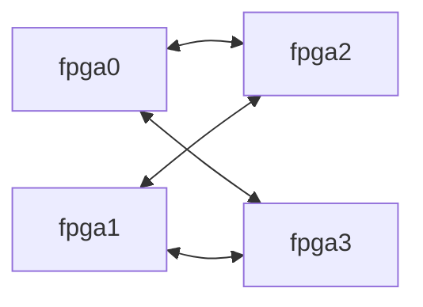

# Hardware platform and inter-FPGA model

This document defines the public research-platform contract used by EmuFlow.
It covers device capacity, topology, link sharing, TDM delay, fixed wiring,
and generated pin constraints. The bundled boards are model-only platforms;
they are not claims about a manufactured board.

`multi-fpga compile` and `run_multi_fpga_flow` use the bundled
`rapidwright_xcvu19p_4fpga_mesh` BoardDB when no platform is supplied.
The two-FPGA `rapidwright_xcvu19p_2fpga_p2p` model uses the same link rules for
single-hop work. These are specified research models, qualified as
**model-only**; their link parameters are not hardware timing signoff.
An explicit `--platform` or Python `platform_path` selects that BoardDB's own
capacity, topology, and delay definitions.

Device capacity comes from the matching RapidWright device/provider inventory
for `xcvu19p-fsva3824-2-e`, with LUT, FF, BRAM18K, DSP48, carry, and URAM units
kept distinct. The default four-FPGA preset applies a strict
`utilization_limit` of **0.25 per FPGA**, measured against each device's raw
capacity independently for LUT, FF, BRAM18K, DSP48, CARRY8, and URAM288.
The two-FPGA comparison preset retains its explicit 0.75 limit.
Partitioning defaults to a **0.1 balance tolerance for cells, LUTs, and FFs**.
For four equal-capacity FPGAs, each of those dimensions is therefore limited
to 27.5% of the design total. BRAM18K, DSP48, CARRY8, URAM288, and the other
dedicated-resource dimensions are capacity-only: the partitioner may place an
unequal share on one FPGA when it remains within that FPGA's physical budget.
For each FPGA `i` and physical resource type `r`, the default four-FPGA preset
also enforces
`load[i,r] <= floor(0.25 * raw_capacity[i,r])`.
A partition must satisfy both applicable bounds; neither one is automatically
relaxed. Cell count remains a partition-size statistic rather than a substitute
for a physical resource budget.

TritonPart initialization uses an envelope derived from these resource and
logic-balance bounds, including the feasible lower bounds. The native legalizer,
PATRON refinement, and independent validators enforce the same limits.
The minimum number of used FPGAs remains mandatory. PATRON candidate selection
and independent validators must preserve this requirement.

Balance remains observable in `balance_observation`:

- `design_share_by_fpga[i][r]` is `load[i,r] / sum_j(load[j,r])`.
- `max_to_mean_by_dimension[r]` is
  `N * max_i(load[i,r]) / sum_j(load[j,r])` across the active FPGAs.
  For four identical FPGAs, a largest design share of 30% gives a ratio of
  `1.2`; that ratio alone does not fail validation. A ratio of `1` means
  equal loads. A dimension with zero total load reports `0` for both metrics.
- Resource utilization uses the effective capacity as its denominator.
  `max_balance_limit_ratio` measures load relative to an enforced upper bound;
  it must not be interpreted as the maximum-to-mean balance ratio.

The default `balance_dimensions` array is `cells`, `lut`, and `ff`. An explicit
array can select a different set or request capacity-only partitioning with an
empty list. For selected dimensions, `balance_tolerance` (default `0.1`) and
optional per-dimension overrides bound the capacity-proportional design share
in addition to physical capacity. Setting the tolerance to zero requests exact
proportional balance for those selected dimensions. Reports identify `strict_balance_dimensions`,
`capacity_only_dimensions`, and the constraint mode for each dimension.
Previously sealed artifacts retain their recorded constraints during
validation. Indivisible/fixed clusters, repair passes, and validators never
automatically relax an applicable capacity or explicit balance bound.

`resource_reservations_by_fpga` optionally reserves downstream physical
resources such as transport LUTs and FFs. For FPGA `i` and resource `r`, Phase
3 uses `planning_capacity[i,r] = effective_capacity[i,r] - reservation[i,r]`.
The capacity-proportional share used by `balance_tolerance` is still computed
from `effective_capacity`; a reservation can tighten an FPGA's integer upper
bound but cannot redefine balance. TritonPart, the hop refiner, PATRON, indexed terminal validation, and
artifact replay consume
the same sealed value. Phase 6 copies it into the split manifest. Phase 7
independently aggregates the synthesized transport resources from compact
SQLite, requires each total to fit its reservation, and separately requires
the combined mapped and materialized design to fit the unchanged physical
capacity. An underestimated reservation fails closed and must be increased by
an explicit rerun from the saved Phase 1--2 boundary.

Phase 3 passes exact per-FPGA, per-resource integer upper bounds to the
in-tree OpenROAD/TritonPart solver with `-resource_bounds_file`. Its compact
text format starts with `num_parts num_dimensions`; each subsequent row is one
partition, with `lower upper` pairs in hMetis vertex-weight dimension order.
EmuFlow exports zero lower bounds because its contract limits maximum loads;
minimum occupancy is checked separately. This represents capacity-only rare
resources, explicitly balanced dimensions, and transport reservations without
relaxing unrelated dimensions through a scalar UBfactor. The scalar remains a
compatibility envelope; the absolute bounds override it throughout solving and
final evaluation.

Coarsening, FM moves, initialization selection, and final acceptance check every
resource independently, including equality at a bound and zero-weight resources.
If a coarse graph has no feasible initial candidate, initialization retries at a
finer level. An illegal candidate is never padded into the chosen set or written
as a successful solution. Python independently recomputes resource loads before
publishing an assignment. There is no post-provider resource legalizer and no
balance-repair CLI option. PATRON starts only from an accepted legal assignment.
The separate minimum-used-FPGA repair remains controlled by
`--no-partition-repair-min-used-fpgas` (or the Phase 3
`--no-tritonpart-repair-min-used-fpgas` option), with final capacity and occupancy
checks always enforced.

Design and communication logic consume the device resources. FPGA-internal
path delays come from the physical backend and STA.
RapidWright checks the whole-device budget after transport mapping, before
routing the materialized circuit, and against its final occupied resources.
DSP component expansion counts one DSP site, paired LUT halves count one CLB
LUT, and BRAM36 consumes two BRAM18K units. Clock-prefilter logic is included.
Completed partition assembly rejects missing or mismatched resource-budget
evidence. Indexed Phase 3 publication seals the requested constraints;
terminal SQLite validation independently recomputes primary loads, replicated
capacity usage, and any explicitly selected balance bounds against the
selected platform. Reports cannot widen a configured bound or reuse a
different device budget. Full-device placement and OpenPARF density do not
redefine the whole-device utilization denominator or relax its limit.
Passing partition resource checks does not establish physical routability or
whole-design timing closure; those require the Phase 7 and global timing
results for the same configuration.

The four-FPGA topology connects each of `fpga0` and `fpga1` to both `fpga2` and
`fpga3`. There is no direct `fpga0`–`fpga1` or `fpga2`–`fpga3` link:



Each direct FPGA pair is connected by **6 cables**. Each cable uses **3 HP I/O
banks at each endpoint**, paired with the corresponding banks at the other
FPGA. This gives **18 bank groups per pair**, shared between the two directions.
Each HP bank supplies **20 differential data pairs** (40 data pins), for
**360 shared differential channels per FPGA pair**. Each scheduled `wire` is
one differential channel: two physical conductors carry one bit together.
Thus each direct FPGA pair has 720 data conductors and uses 720 data pins at
each endpoint. The 20-pair setting is the usable data width of this model.

The device inventory is **38 HP banks and 4 HD banks per FPGA**. Each FPGA in
the four-FPGA topology has two direct neighbors, so those links use
`2 * 6 * 3 = 36` HP banks at that FPGA. The remaining 2 HP banks and the 4 HD
banks are outside this inter-FPGA capacity pool. The two-FPGA variant uses
18 HP banks at each endpoint.

Phase 5 first chooses a whole-bank split from the two directional loads,
minimizing the worst predicted TDM ratio and then the sum of predicted ratios.
It then assigns TDM ratios and slots within that bank allocation and validates
the result. Banks within one cable can serve different
directions, but one bank cannot alternate directions between slots of the same
schedule. For each connected pair:

```text
b_AB, b_BA are nonnegative integers
b_AB + b_BA <= 18
C_AB = 20 * b_AB differential channels
C_BA = 20 * b_BA differential channels
```

For example, a 7/11 split gives 140 differential channels A→B and 220 B→A;
a 9/9 split provides 180 differential channels in each direction. Idle bank groups may remain unassigned.
BoardDB records `cable_count: 6`, `hp_banks_per_cable: 3`, `bank_count: 18`,
`wires_per_bank: 20`, and `capacity_sharing: "shared_bidirectional"`.
`data_lanes_per_direction: 360` is the pair's shared pool before directional
allocation; it does not provide 360 independent channels in both directions.
`wires_per_bank` counts differential pairs for this LVDS virtual-board model;
P/N conductors are never assigned separate TDM ratios or slots.

The single-hop net delay uses the TDM ratio assigned to that net on that hop:

```text
d_net(R) = 30 + 0.5 * R                       [ns]
path delay = intra-FPGA delay + sum_h d_net(R_h)
```

Thus `R=8` gives 34 ns and `R=16` gives 38 ns. A two-hop path with ratios 8 and
16 contributes 72 ns of cross-FPGA delay; each hop is evaluated separately.
This platform permits exactly `R = 8, 16, ..., 256`. A load requiring `R > 256`
is infeasible for the link; increasing `frame_slots` does not legalize it.
The ratio term is already included in `d_net`, so this model does not add a
second slot-wait or serialization-delay term. The 250 MHz fabric clock controls
the concrete slot schedule; it does not replace the nanosecond delay formula.
`latency_cycles: 9` is the minimum-ratio bound (`ceil(d_net(8) / 4)`). The
scheduler computes `ceil(d_net(R) / 4)` for each entry's actual ratio.
BoardDB records the formula explicitly:

```json
{
  "tdm_delay_model": {
    "model": "linear-ratio-v1",
    "intercept_ns": 30.0,
    "ratio_coefficient_ns": 0.5,
    "min_ratio": 8,
    "max_ratio": 256,
    "ratio_quantum": 8
  }
}
```

BoardDB is the canonical owner of this ratio domain. Normalized Phase 3--5
route constraints copy it as `tdm_min_ratio`, `tdm_max_ratio`, and
`tdm_ratio_quantum` so native optimizers and independent validators consume
the same sealed values.

Export either bundled platform for inspection or standalone phase commands.
`--wires-per-bank` explicitly overrides the effective data width when defining
a different research configuration; its default is 20:

```bash
emuflow platform research-model --wires-per-bank 20 --output build/research-boarddb.json
emuflow platform research-model --fpga-count 2 --output build/two-fpga-boarddb.json
emuflow platform validate build/research-boarddb.json

# Omit --platform to use the bundled four-FPGA model.
emuflow multi-fpga compile design.v --top top \
  --clock clk --clock-period clk=10 --out build/design

# Select a different platform explicitly.
emuflow multi-fpga compile design.v --top top \
  --clock clk --clock-period clk=10 \
  --platform build/two-fpga-boarddb.json --out build/design-two-fpga
```

The Python equivalent is `run_multi_fpga_flow(output_dir=..., sources=...,
top=..., clocks=..., clock_periods=...)`; pass `platform_path=...` to override
the same default. The bundled models are installed with the Python package
and the CMake CLI, so default selection does not depend on the current working
directory. `--physical` and the matching backend inputs are still required for
physical implementation and global physical timing. The bundled virtual-board
model now emits schedule-aware data-pin bindings as described below. The existing
independent-direction Phase 8A requirements exporter still rejects shared-bank
platforms instead of assigning two independent 360-wire pools.


## Fixed virtual board wiring

Both bundled XCVU19P presets declare
`virtual_board_model: xcvu19p-hp-lvds-cable-v1` and an explicit
`virtual_board_wiring` CSV. That checked-in table is the authoritative board
connection source consumed by Phase 6; the deterministic model and device-pin
inventory independently reject a stale or altered table. The table pairs **real device
P/N package pins** through **hypothetical fixed cables**, connecting P to P
and N to N. Each endpoint records its HP bank, vendor differential-pair ID,
both package pins, pin functions, and IOB sites. RapidWright supplies the
package-pin/site identity inventory; the AMD package pinout supplies the
P/N identities ([AMD FSVA3824 pinout, revision 1.3](https://download.amd.com/adaptive-socs-and-fpgas/developer/adaptive-socs-and-fpgas/package-pinout-files/usapackages/xcvu19pfsva3824pkg.txt)). Cable routing and connector data-contact numbering are model
assumptions, not observations of a commercial board.

The generator reserves configuration-multiplexed bank 65, then sorts link IDs
and assigns 18 unused HP banks at each endpoint of each link. It selects
complete vendor differential pairs in numeric pair-ID order, preferring the
20 non-GC pairs so the four global-clock pairs remain available by default. It never infers differential pairing
from adjacent package-pin names or IOB coordinates. Single-ended-only pins are
excluded. Bank group `g` belongs to cable `g // 3`; wire `w` belongs to bank
group `w // 20` with position `w % 20` at the default width. A cable has 60
differential data channels and 120 data-contact ordinals at each end.

The four-FPGA model has 24 cables, 1,440 differential channels and 2,880 signal
conductors. Each FPGA uses 36 distinct HP banks and 1,440 data pins; HP banks 65 and 78
remain outside the data network. No bank or pin is reused for a different
neighbor. The two-FPGA model has six cables and 360 differential channels.

There is **one undirected connection per differential channel**. Phase 5
assigns whole-bank directions for a generated schedule/build; reversing a bank
swaps transmitter and receiver on its fixed P/N pairs without changing polarity.
TDM communications in different slots reuse the same pair. P and N share one
wire index, TDM ratio and slot; they do not double the schedule capacity.

The checked-in [four-FPGA wire table](../platforms/virtual/rapidwright_xcvu19p_4fpga_mesh.wires.csv)
and [two-FPGA wire table](../platforms/virtual/rapidwright_xcvu19p_2fpga_p2p.wires.csv)
list all four package pins of every fixed differential connection. Regenerate
JSON/CSV tables without compiling a design:

```sh
python -m emuflow.virtual_board --out build/virtual-board
# Optional: --platform platforms/virtual/rapidwright_xcvu19p_2fpga_p2p.json
```

During Phase 6, a declared virtual board automatically produces:

- `split/virtual_board_wiring.json`: the fixed differential connection inventory;
- `split/virtual_board_binding.json`: each scheduled hop's wire, slot, TDM ratio,
  logical transport bit, and both endpoints' P/N pin/port identities;
- `split/<fpga>/virtual_data_pins.xdc`: `PACKAGE_PIN` and `IOSTANDARD LVDS`
  constraints for both polarities of used channels, with TDM reuse deduplicated;
- `split/<fpga>/virtual_differential_io.sv`: the differential adapter contract using
  `OBUFDS` at transmitters and `IBUFDS` at receivers. Its logical buses connect
  to transport RTL and its P/N ports define the physical top-level interface.

The Phase 6 validator checks these files against the device inventory, schedule,
transport ports and bank direction allocation. It rejects missing or altered
bindings, polarity swaps, pin collisions, and modified XDC or adapter RTL. The
logical netlist/anchor artifacts keep their existing board-independent status;
the separate virtual-board result records the additional differential binding.

The board assumes HP-bank `LVDS` at 1.8 V VCCO and internal 100-ohm receiver
termination (`IBUFDS.DIFF_TERM=TRUE`), enabled only at the receiving end
([AMD UG571, LVDS](https://docs.amd.com/api/khub/documents/kFbaUC5HGcXyGNauhgU6Gw/content)). These are design assumptions, not electrical
signoff. Clock/reset/control pins, power/ground wiring, configuration-pin reuse,
and a cable product's connector pinout need board-specific constraints. The
Phase 7 fails closed if the binding, adapter, or XDC differ. The RapidWright
backend consumes that sealed contract, lowers each used LVDS pair to a fixed
IOB at the P package pin with the inventory-verified N mate, and includes the
IOB boundary in routing and boundary timing. Its physical summary reports exact
lane/port/package-pin coverage. This is a routed research implementation, not
board electrical signoff: RapidWright's lightweight timing model does not
characterize the differential buffer's intrinsic delay, and the clock/reset/
control services above remain board-specific. Link timing keeps the configured
per-hop `30 + 0.5R` ns model; switching to differential does not recalibrate it.
